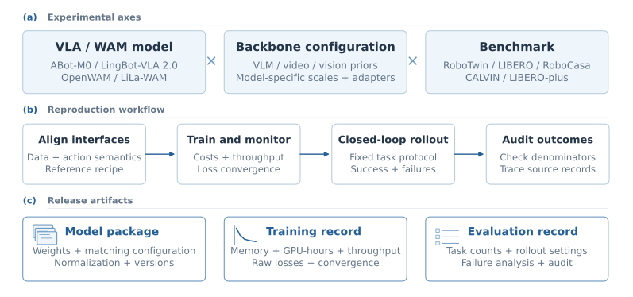

<div align="center">

# RoboSeed

### Reproducing Vision–Language–Action Models, from Training to Closed-Loop Evaluation

**RoboSeed Team**

<p>
  &nbsp;&nbsp;&nbsp;&nbsp;
  
</p>

<p>
  <a href="docs/report/RoboSeed.pdf"></a>
  <a href="docs/experiments/README.md"></a>
  <a href="data/README.md"></a>
  <a href="docs/releases/README.md"></a>
</p>

[Overview](#overview) · [Results](#results) · [Documentation](docs/README.md) · [Citation](#citation)

<p><strong>An open experimental record of action-model reproduction,<br>backbone adaptation, training cost, and robot execution.</strong></p>



<p><em>RoboSeed organizes action models, VLM backbones, and benchmarks through a shared reproduction workflow. Each experiment connects its configuration and training record to closed-loop outcomes and release artifacts.</em></p>

</div>

## Overview

RoboSeed reproduces published vision–language–action models and studies how their behavior changes with VLM backbones and execution environments. We share the settings, resource costs, task-level outcomes, and evidence needed to understand a result and repeat its analysis. **ABot-M0 is our first reproduced action model**; additional models will receive their own experiment sections within the same structure.

The project is organized along three experimental axes: **action models, VLM backbones and scales, and benchmarks**. The current release covers six RoboTwin training runs, five complete backbone evaluations, and Qwen3.5-4B experiments on LIBERO, LIBERO-plus, RoboCasa GR1 Tabletop, and CALVIN. Dataset-specific policies are trained independently; LIBERO-plus evaluates the LIBERO policy without additional training.

- **Compare capability and budget:** backbone substitutions, training time, GPU-hours, resource observations, and closed-loop success under recorded settings.
- **Follow training through execution:** configurations, loss curves, rollout protocols, task counts, and failure analysis connect each result to its evidence.
- **Reproduce and extend community models:** one section per action model, with backbone and benchmark records that can grow as new methods are evaluated.

**2026-10-12 update:** adds the completed RoboTwin 9B evaluation and CALVIN long-horizon results, expands LIBERO-plus and RoboCasa records, and includes the current technical report. Qwen3.5-2B training is complete; its RoboTwin evaluation is pending in this release.

## Start here

| What you want to do | Entry point |
| --- | --- |
| Understand the project and its experiment structure | [Documentation guide](docs/README.md) |
| Compare scale, cost, robustness, and failure patterns | [Experimental findings](docs/findings/README.md) |
| Read the full study | [Technical report and reading guide](docs/report/README.md) |
| Inspect a run's settings and task counts | [Experiment index](docs/experiments/README.md) |
| Regenerate the published analysis | [Reproduction guide](docs/reproduction/README.md) |

## Results

### RoboTwin · ABot-M0

Every evaluated backbone uses **150k post-train updates**, global batch 64, and four H200 NVL GPUs. Training includes both Clean and Randomized demonstrations and omits the unified robotic pre-train stage. Each scene evaluates **50 tasks × 100 episodes**, with launch seed 0 and unseen instructions. Average equally weights the two scenes.

<!-- BEGIN GENERATED robotwin -->
| VLM backbone | Clean (%) | Randomized (%) | Average (%) | Training GPU-hours |
| --- | --- | --- | --- | --- |
| [Qwen3.5-0.8B](docs/experiments/abot-m0/robotwin/qwen3-5-0-8b.md) | 80.76 | 80.50 | 80.63 | 174.1 |
| [Qwen3-VL-2B](docs/experiments/abot-m0/robotwin/qwen3-vl-2b.md) | 83.66 | 83.90 | 83.78 | 214.0 |
| [Qwen3-VL-4B](docs/experiments/abot-m0/robotwin/qwen3-vl-4b.md) | 85.70 | 85.34 | 85.52 | 288.1 |
| [Qwen3.5-4B](docs/experiments/abot-m0/robotwin/qwen3-5-4b.md) | 85.88 | 85.12 | 85.50 | 394.4 |
| [Qwen3.5-9B](docs/experiments/abot-m0/robotwin/qwen3-5-9b.md) | 83.98 | 83.68 | 83.83 | 509.2 |
<!-- END GENERATED robotwin -->

GPU-hours cover training only. Backbone sizes name the VLM component, rather than the total policy parameter count. Equal update counts do not imply equal compute. The 4B scores are close in this setting; the 9B run uses more compute without improving aggregate success. These are results from the recorded recipe and training seed, rather than a claim of statistical equivalence or a matched public leaderboard submission.

**Training complete; evaluation pending**

<!-- BEGIN GENERATED robotwin_pending -->
| VLM backbone | Post-train updates | Training GPU-hours | Evaluation status |
| --- | --- | --- | --- |
| [Qwen3.5-2B](docs/experiments/abot-m0/robotwin/qwen3-5-2b.md) | 150,000 | 212.9 | Pending at the report snapshot |
<!-- END GENERATED robotwin_pending -->

The pending run has no complete success score at the report snapshot and is tracked separately from evaluated backbones.

<details>
<summary>View success and training cost</summary>

<p align="center"></p>

Each bar starts at zero. Training cost is four GPUs multiplied by recorded wall time; rollout cost is reported separately in the experiment pages.

</details>

### Beyond RoboTwin · ABot-M0 × Qwen3.5-4B

<!-- BEGIN GENERATED benchmarks -->
| Benchmark | Post-train updates | Evaluation counts | Result |
| --- | --- | --- | --- |
| [LIBERO](docs/experiments/abot-m0/libero/qwen3-5-4b.md) | 40k | 1,935/2,000 | 96.75% |
| [LIBERO-plus](docs/experiments/abot-m0/liberoplus/qwen3-5-4b.md) | No extra training | 8,027/10,030 | 80.03% |
| [RoboCasa GR1 Tabletop](docs/experiments/abot-m0/robocasa-tabletop/qwen3-5-4b.md) | 50k | 574/1,200 | 47.83% |
| [CALVIN · ABCD → D](docs/experiments/abot-m0/calvin/qwen3-5-4b.md) | 34k | 1,000 five-task sequences | Mean length **3.625 / 5**; five tasks **57.1%** |
<!-- END GENERATED benchmarks -->

**CALVIN uses ABCD training and D evaluation: environment D is included in training.** Mean chain length measures consecutive completed instructions out of five; it is distinct from isolated episode success. LIBERO-plus uses the LIBERO checkpoint with no extra training, and its score weights all variants by their actual counts. Results across benchmarks are reported separately.

<details>
<summary>View CALVIN chain completion</summary>

<!-- BEGIN GENERATED calvin_chain -->
| Consecutive tasks completed | Sequences / 1,000 | Completion (%) |
| --- | --- | --- |
| 1 | 889 | 88.9 |
| 2 | 798 | 79.8 |
| 3 | 721 | 72.1 |
| 4 | 646 | 64.6 |
| 5 | 571 | 57.1 |
<!-- END GENERATED calvin_chain -->

All 1,000 sequences contribute to every prefix denominator. Conditional task rates use only reached attempts; see the [complete CALVIN record](docs/experiments/abot-m0/calvin/qwen3-5-4b.md).

</details>

Read the [experimental findings](docs/findings/README.md) for the report's scale and budget comparisons, late-training loss analysis, LIBERO-plus perturbation breakdown, and CALVIN failure groups.

## Available in this release

| Artifact | Availability |
| --- | --- |
| Technical report and ten editable scientific figure sets | [PDF and report guide](docs/report/README.md); [SVG / PDF / PNG figures](docs/figure/results/) |
| Audited results, loss observations, and source-selection records | [Machine-readable data and schemas](data/README.md) |
| Nine recorded training configurations | [Configuration index](configs/README.md) |
| Analysis scripts and automated consistency checks | [Reproduction guide](docs/reproduction/README.md) |
| Locally trained policy weights | [Nine recorded artifacts](docs/releases/README.md); public downloads pending |
| Training implementation, simulator adapters, datasets, and raw videos | External to this repository; required components are described in the [reproduction guide](docs/reproduction/README.md) |

The available scripts reproduce the published analysis and figures from packaged records. The recorded YAML files describe the training runs and require a compatible implementation, datasets, and initialization to repeat training.

## Explore the experiments

| Index | Coverage |
| --- | --- |
| [Action models](docs/action_models/README.md) | ABot-M0 architecture, adaptation choices, and experiment records |
| [VLM backbones](docs/models/README.md) | Qwen3-VL 2B / 4B; Qwen3.5 0.8B / 2B / 4B / 9B; historical 8B diagnostics |
| [Benchmarks](docs/datasets/README.md) | RoboTwin, LIBERO, LIBERO-plus, RoboCasa GR1 Tabletop, and CALVIN |
| [All runs](docs/experiments/README.md) | Training configuration, evaluation protocol, cost, and task results |
| [Earlier pre-train → post-train study](docs/experiments/abot-m0/robotwin/pre-train-to-post-train-diagnostic.md) | Separate 10-episode Clean diagnostics and upstream-weight comparisons |
| [Data and provenance](data/README.md) | CSV schemas, source hashes, video verdicts, and duplicate-resolution audits |
| [Checkpoint registry](docs/releases/README.md) | Nine verified local artifacts; public download URLs pending |

## Contributing

New action models, backbone substitutions, evaluation results, and corrections are welcome. Follow [CONTRIBUTING.md](CONTRIBUTING.md) to add a model section and attach its configurations, counts, protocols, and evidence. Pending evaluations remain separate from completed comparisons. Please use [GitHub issues](https://github.com/PrimitiveX/AMseed/issues) to report a discrepancy with the relevant run and evidence file.

## Citation

If you use the experimental records or analysis tools, cite this repository and the technical report:

```bibtex
@misc{roboseed2026,
  title        = {RoboSeed: Reproducing Vision-Language-Action Models},
  author       = {{RoboSeed Team}},
  year         = {2026},
  howpublished = {\url{https://github.com/PrimitiveX/AMseed}},
  note         = {Technical report and experimental records, October 12 release}
}
```

Please also cite the original action models, VLMs, and benchmarks used in your experiment. Our ABot-M0 reproduction builds on the [ABot-M0 implementation](https://github.com/amap-cvlab/ABot-Manipulation/tree/ABot-M0) and [paper](https://arxiv.org/abs/2602.11236). Official model and benchmark references are linked in their individual pages.
