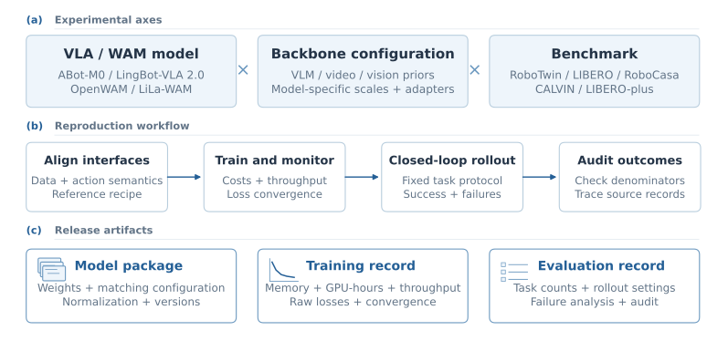
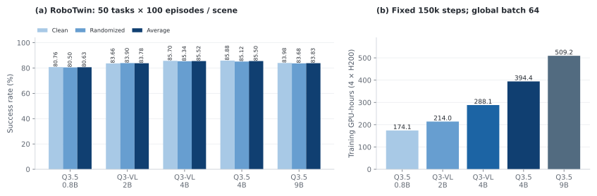

<div align="center">

# RoboSeed

### Reproducing Frontier Action Models, from Training to Closed-Loop Evaluation

**RoboSeed Team**

<p>
  &nbsp;&nbsp;&nbsp;&nbsp;
  
</p>

<p>
  <a href="docs/report/RoboSeed.pdf"></a>
  <a href="docs/experiments/README.md"></a>
  <a href="data/README.md"></a>
  <a href="docs/releases/README.md"></a>
</p>

[Overview](#overview) · [Updates](#updates) · [Results](#results) · [Model weights](docs/releases/README.md) · [To-do list](#to-do-list) · [Documentation](docs/README.md) · [Citation](#citation)

<p><strong>An open experimental record of action-model reproduction,<br>backbone adaptation, training cost, and robot execution.</strong></p>



<p><em>RoboSeed organizes action models, VLM backbones, and benchmarks through a shared reproduction workflow. Each experiment connects its configuration and training record to closed-loop outcomes and release artifacts.</em></p>

</div>

## Overview

RoboSeed reproduces **vision–language–action (VLA) and world–action models (WAM)** and connects each checkpoint to its training recipe, evaluation interface, resource cost and task-level evidence. The current study covers **ABot-M0, LingBot-VLA 2.0, OpenWAM and LiLa-WAM**. Backbone substitutions stay within each model family; independently trained benchmark policies retain their own records.

The table below lists **all 16 current evaluated checkpoint/benchmark records**: six ABot-M0 RoboTwin backbones, four additional benchmark evaluations, and six official/local VLA and WAM records. It also includes the **historical Qwen3-VL-8B diagnostic**, which uses a separate 500-episode protocol. Click a model to open its experiment, protocol, task results and model-weight status.

<!-- BEGIN GENERATED overview -->
| Model / experiment | Benchmark | Checkpoint origin | Key metrics | Evaluation counts | Local training GPU-hours |
| --- | --- | --- | --- | --- | --- |
| [ABot-M0 · Qwen3.5-0.8B](docs/experiments/abot-m0/robotwin/qwen3-5-0-8b.md) | RoboTwin | Local | Clean 80.76%; Randomized 80.50%; mean **80.63%** | 5,000 episodes / scene | 174.1 |
| [ABot-M0 · Qwen3-VL-2B](docs/experiments/abot-m0/robotwin/qwen3-vl-2b.md) | RoboTwin | Local | Clean 83.66%; Randomized 83.90%; mean **83.78%** | 5,000 episodes / scene | 214.0 |
| [ABot-M0 · Qwen3-VL-4B](docs/experiments/abot-m0/robotwin/qwen3-vl-4b.md) | RoboTwin | Local | Clean 85.70%; Randomized 85.34%; mean **85.52%** | 5,000 episodes / scene | 288.1 |
| [ABot-M0 · Qwen3.5-2B](docs/experiments/abot-m0/robotwin/qwen3-5-2b.md) | RoboTwin | Local | Clean 84.30%; Randomized 83.94%; mean **84.12%** | 5,000 episodes / scene | 212.9 |
| [ABot-M0 · Qwen3.5-4B](docs/experiments/abot-m0/robotwin/qwen3-5-4b.md) | RoboTwin | Local | Clean 85.88%; Randomized 85.12%; mean **85.50%** | 5,000 episodes / scene | 394.4 |
| [ABot-M0 · Qwen3.5-9B](docs/experiments/abot-m0/robotwin/qwen3-5-9b.md) | RoboTwin | Local | Clean 83.98%; Randomized 83.68%; mean **83.83%** | 5,000 episodes / scene | 509.2 |
| [ABot-M0 · Qwen3.5-4B](docs/experiments/abot-m0/libero/qwen3-5-4b.md) | LIBERO | Local | **96.75%** | 1,935/2,000 | See run record |
| [ABot-M0 · Qwen3.5-4B](docs/experiments/abot-m0/liberoplus/qwen3-5-4b.md) | LIBERO-plus | Local · LIBERO weights reused | **80.03%** | 8,027/10,030 | No extra training |
| [ABot-M0 · Qwen3.5-4B](docs/experiments/abot-m0/robocasa-tabletop/qwen3-5-4b.md) | RoboCasa GR1 Tabletop | Local | **47.83%** | 574/1,200 | See run record |
| [ABot-M0 · Qwen3.5-4B](docs/experiments/abot-m0/calvin/qwen3-5-4b.md) | CALVIN · ABCD → D | Local | Mean chain **3.625 / 5**; five tasks 57.1% | 1,000 sequences | 58.7 |
| [LingBot-VLA 2.0 · 6B official](docs/experiments/lingbot-vla2/robotwin/README.md) | RoboTwin | Released weights | Clean 89.72%; Randomized — | 5,000 episodes / evaluated scene | — |
| [LingBot-VLA 2.0 · 6B local](docs/experiments/lingbot-vla2/robotwin/README.md) | RoboTwin | Local budget run | Clean 57.78%; Randomized — | 5,000 episodes / evaluated scene | 174.365 |
| [OpenWAM official](docs/experiments/openwam/robotwin/README.md) | RoboTwin | Released weights | Clean 94.02%; Randomized 93.66% | 5,000 episodes / evaluated scene | — |
| [OpenWAM local](docs/experiments/openwam/robotwin/README.md) | RoboTwin | Local budget run | Clean 91.30%; Randomized 91.40% | 5,000 episodes / evaluated scene | 262.068 |
| [LiLa-WAM official](docs/experiments/lila-wam/robotwin/README.md) | RoboTwin | Released weights | Clean 89.60%; Randomized — | 250 episodes / evaluated scene | — |
| [LiLa-WAM local](docs/experiments/lila-wam/robotwin/README.md) | RoboTwin | Local budget run | Clean 88.80%; Randomized — | 250 episodes / evaluated scene | — |
| [ABot-M0 · Qwen3-VL-8B](docs/experiments/abot-m0/robotwin/pre-train-to-post-train-diagnostic.md) | RoboTwin · historical diagnostic | Local pre-train → post-train | Clean 73/500 (14.6%) | 500 episodes; 10 / task | Not established |
<!-- END GENERATED overview -->

RoboTwin ABot means equally weight Clean and Randomized; each scene has 50 tasks. LingBot and OpenWAM use 100 episodes per task, while LiLa uses five and task-selected visual conditions. **—** means unavailable, and GPU-hours cover local training only. Released-weight rows are official checkpoints evaluated locally. **CALVIN includes environment D in training** and reports chain length rather than episode success. LIBERO-plus reuses the LIBERO policy. These protocols and training budgets differ across families; see the [comparison scope](docs/reproduction/comparison-protocol.md).

[All 17 checkpoint packages](docs/releases/README.md) include 12 evaluated local policies, three official references and two training prefixes without independent rollouts. The prefixes remain outside the completed-result table; [historical pre-train → post-train diagnostics](docs/experiments/abot-m0/robotwin/pre-train-to-post-train-diagnostic.md) retain their separate 500-episode protocol.

The [technical report](docs/report/README.md) evaluates capability, downstream training affordability, deployment affordability, locally verified research value and reproduction evidence. Missing measurements remain explicit. Model families have different inherited priors, observation/action interfaces and evaluation paths; the cross-family results describe the recorded recipes and do not isolate architecture effects.

## Updates

- **2026-11-02 · Homepage inventory and model timeline:** add the complete Overview table and the dated result-artifact index below.
- **2026-10-29 · Report and checkpoint release:** publish the 2026-10-28 evidence snapshot, complete the six-backbone ABot-M0 comparison (including Qwen3.5-2B at 84.12% mean), add official/local LingBot, OpenWAM and LiLa results, and link all 17 ModelScope packages. Include full-task PX harness measurements and clarify the practical-budget comparison scope.
- **2026-10-12 · Benchmark records and report:** publish the completed Qwen3.5-9B, LIBERO, LIBERO-plus, RoboCasa and CALVIN records, training configurations, audited data and technical report. Qwen3.5-2B was training-only at that release.

The timeline below lists each model's **latest selected result-artifact modification time**, in full UTC date and time, sorted newest first. It uses the original task-result files, complete stats, worker results or selected rollout videos. These timestamps describe result records; files can be rewritten after a run, so they do not establish exact training or evaluation completion times. Repository publication dates are listed above. [Timestamp provenance, source IDs and hashes](data/model_updates.json) retain the selection and microsecond precision.

<!-- BEGIN GENERATED updates -->
| Result artifacts last updated (UTC) | Model / experiment | Benchmark |
| --- | --- | --- |
| 2026-10-26 15:39:26 | [LiLa-WAM local](docs/experiments/lila-wam/robotwin/README.md) | RoboTwin |
| 2026-10-26 07:23:02 | [LiLa-WAM official](docs/experiments/lila-wam/robotwin/README.md) | RoboTwin |
| 2026-10-20 17:32:10 | [OpenWAM local](docs/experiments/openwam/robotwin/README.md) | RoboTwin |
| 2026-10-18 11:17:43 | [LingBot-VLA 2.0 · 6B local](docs/experiments/lingbot-vla2/robotwin/README.md) | RoboTwin |
| 2026-10-15 16:14:07 | [OpenWAM official](docs/experiments/openwam/robotwin/README.md) | RoboTwin |
| 2026-10-14 23:27:18 | [LingBot-VLA 2.0 · 6B official](docs/experiments/lingbot-vla2/robotwin/README.md) | RoboTwin |
| 2026-10-13 07:35:53 | [ABot-M0 · Qwen3.5-2B](docs/experiments/abot-m0/robotwin/qwen3-5-2b.md) | RoboTwin |
| 2026-10-10 13:43:00 | [ABot-M0 · Qwen3.5-4B](docs/experiments/abot-m0/calvin/qwen3-5-4b.md) | CALVIN · ABCD → D |
| 2026-10-04 03:39:45 | [ABot-M0 · Qwen3.5-9B](docs/experiments/abot-m0/robotwin/qwen3-5-9b.md) | RoboTwin |
| 2026-09-29 19:46:27 | [ABot-M0 · Qwen3.5-4B](docs/experiments/abot-m0/liberoplus/qwen3-5-4b.md) | LIBERO-plus |
| 2026-09-28 07:50:24 | [ABot-M0 · Qwen3.5-4B](docs/experiments/abot-m0/robocasa-tabletop/qwen3-5-4b.md) | RoboCasa GR1 Tabletop |
| 2026-09-26 15:07:47 | [ABot-M0 · Qwen3.5-0.8B](docs/experiments/abot-m0/robotwin/qwen3-5-0-8b.md) | RoboTwin |
| 2026-09-26 09:02:40 | [ABot-M0 · Qwen3.5-4B](docs/experiments/abot-m0/libero/qwen3-5-4b.md) | LIBERO |
| 2026-09-25 21:25:32 | [ABot-M0 · Qwen3-VL-2B](docs/experiments/abot-m0/robotwin/qwen3-vl-2b.md) | RoboTwin |
| 2026-09-23 01:29:51 | [ABot-M0 · Qwen3.5-4B](docs/experiments/abot-m0/robotwin/qwen3-5-4b.md) | RoboTwin |
| 2026-09-21 09:15:37 | [ABot-M0 · Qwen3-VL-4B](docs/experiments/abot-m0/robotwin/qwen3-vl-4b.md) | RoboTwin |
<!-- END GENERATED updates -->

See the [changelog](CHANGELOG.md) for release details.

The historical Qwen3-VL-8B diagnostic was already documented in the 2026-10-12 release; its exact result completion timestamp is not recorded and is not inferred from that release date.

## Start here

| What you want to do | Entry point |
| --- | --- |
| Understand the project and its experiment structure | [Documentation guide](docs/README.md) |
| Compare scale, cost, robustness, and failure patterns | [Experimental findings](docs/findings/README.md) |
| Read the full study | [Technical report and reading guide](docs/report/README.md) |
| Inspect a run's settings and task counts | [Experiment index](docs/experiments/README.md) |
| Regenerate the published analysis | [Reproduction guide](docs/reproduction/README.md) |

## Results

**Comparison objective.** We use the ABot-M0 downstream study as a reference to investigate model behavior at comparable training scales on practical, limited hardware. Some official training recipes exceed the available hardware budget, so our local runs adapt batch sizes, training duration and execution settings. A lower score under a local recipe describes that budgeted experiment; it does not establish the original method’s performance under its full official setup.

**Actual alignment is reported explicitly:** the current local runs use different batch sizes, updates and training units. Comparable-budget evaluation is the objective; exact equality of sample exposure, compute and GPU-hours has not yet been established across all families. See the [comparison protocol and actual training-budget table](docs/reproduction/comparison-protocol.md).

### RoboTwin · ABot-M0

Every evaluated backbone uses **150k post-train updates**, global batch 64, and four H200 NVL GPUs. Training includes both Clean and Randomized demonstrations and omits the unified robotic pre-train stage. Each scene evaluates **50 tasks × 100 episodes**, with launch seed 0 and unseen instructions. Average equally weights the two scenes.

<!-- BEGIN GENERATED robotwin -->
| VLM backbone | Clean (%) | Randomized (%) | Average (%) | Training GPU-hours | Weights |
| --- | --- | --- | --- | --- | --- |
| [Qwen3.5-0.8B](docs/experiments/abot-m0/robotwin/qwen3-5-0-8b.md) | 80.76 | 80.50 | 80.63 | 174.1 | [ModelScope](https://www.modelscope.cn/models/InPeerReview/RoboSeed/tree/master/models/RoboSeed-ABot-M0-RoboTwin-Qwen3.5-0.8B) |
| [Qwen3-VL-2B](docs/experiments/abot-m0/robotwin/qwen3-vl-2b.md) | 83.66 | 83.90 | 83.78 | 214.0 | [ModelScope](https://www.modelscope.cn/models/InPeerReview/RoboSeed/tree/master/models/RoboSeed-ABot-M0-RoboTwin-Qwen3-VL-2B) |
| [Qwen3-VL-4B](docs/experiments/abot-m0/robotwin/qwen3-vl-4b.md) | 85.70 | 85.34 | 85.52 | 288.1 | [ModelScope](https://www.modelscope.cn/models/InPeerReview/RoboSeed/tree/master/models/RoboSeed-ABot-M0-RoboTwin-Qwen3-VL-4B) |
| [Qwen3.5-2B](docs/experiments/abot-m0/robotwin/qwen3-5-2b.md) | 84.30 | 83.94 | 84.12 | 212.9 | [ModelScope](https://www.modelscope.cn/models/InPeerReview/RoboSeed/tree/master/models/RoboSeed-ABot-M0-RoboTwin-Qwen3.5-2B) |
| [Qwen3.5-4B](docs/experiments/abot-m0/robotwin/qwen3-5-4b.md) | 85.88 | 85.12 | 85.50 | 394.4 | [ModelScope](https://www.modelscope.cn/models/InPeerReview/RoboSeed/tree/master/models/RoboSeed-ABot-M0-RoboTwin-Qwen3.5-4B) |
| [Qwen3.5-9B](docs/experiments/abot-m0/robotwin/qwen3-5-9b.md) | 83.98 | 83.68 | 83.83 | 509.2 | [ModelScope](https://www.modelscope.cn/models/InPeerReview/RoboSeed/tree/master/models/RoboSeed-ABot-M0-RoboTwin-Qwen3.5-9B) |
<!-- END GENERATED robotwin -->

GPU-hours cover training only. Backbone sizes name the VLM component, rather than the total policy parameter count. Equal update counts do not imply equal compute. The 4B scores are close in this setting; the 9B run uses more compute without improving aggregate success. These are results from the recorded recipe and training seed, rather than a claim of statistical equivalence or a matched public leaderboard submission.

<!-- BEGIN GENERATED robotwin_pending -->
<!-- END GENERATED robotwin_pending -->

<details>
<summary>View success and training cost</summary>

<p align="center"></p>

Each bar starts at zero. Training cost is four GPUs multiplied by recorded wall time; rollout cost is reported separately in the experiment pages.

</details>

### Beyond RoboTwin · ABot-M0 × Qwen3.5-4B

<!-- BEGIN GENERATED benchmarks -->
| Benchmark | Post-train updates | Evaluation counts | Result | Weights |
| --- | --- | --- | --- | --- |
| [LIBERO](docs/experiments/abot-m0/libero/qwen3-5-4b.md) | 40k | 1,935/2,000 | 96.75% | [ModelScope](https://www.modelscope.cn/models/InPeerReview/RoboSeed/tree/master/models/RoboSeed-ABot-M0-LIBERO-Qwen3.5-4B) |
| [LIBERO-plus](docs/experiments/abot-m0/liberoplus/qwen3-5-4b.md) | No extra training | 8,027/10,030 | 80.03% | [ModelScope](https://www.modelscope.cn/models/InPeerReview/RoboSeed/tree/master/models/RoboSeed-ABot-M0-LIBERO-Qwen3.5-4B) |
| [RoboCasa GR1 Tabletop](docs/experiments/abot-m0/robocasa-tabletop/qwen3-5-4b.md) | 50k | 574/1,200 | 47.83% | [ModelScope](https://www.modelscope.cn/models/InPeerReview/RoboSeed/tree/master/models/RoboSeed-ABot-M0-RoboCasa-Qwen3.5-4B) |
| [CALVIN · ABCD → D](docs/experiments/abot-m0/calvin/qwen3-5-4b.md) | 34k | 1,000 five-task sequences | Mean length **3.625 / 5**; five tasks **57.1%** | [ModelScope](https://www.modelscope.cn/models/InPeerReview/RoboSeed/tree/master/models/RoboSeed-ABot-M0-CALVIN-Qwen3.5-4B) |
<!-- END GENERATED benchmarks -->

**CALVIN uses ABCD training and D evaluation: environment D is included in training.** Mean chain length measures consecutive completed instructions out of five; it is distinct from isolated episode success. LIBERO-plus uses the LIBERO checkpoint with no extra training, and its score weights all variants by their actual counts. Results across benchmarks are reported separately.

<details>
<summary>View CALVIN chain completion</summary>

<!-- BEGIN GENERATED calvin_chain -->
| Consecutive tasks completed | Sequences / 1,000 | Completion (%) |
| --- | --- | --- |
| 1 | 889 | 88.9 |
| 2 | 798 | 79.8 |
| 3 | 721 | 72.1 |
| 4 | 646 | 64.6 |
| 5 | 571 | 57.1 |
<!-- END GENERATED calvin_chain -->

All 1,000 sequences contribute to every prefix denominator. Conditional task rates use only reached attempts; see the [complete CALVIN record](docs/experiments/abot-m0/calvin/qwen3-5-4b.md).

</details>

Read the [experimental findings](docs/findings/README.md) for the report's scale and budget comparisons, late-training loss analysis, LIBERO-plus perturbation breakdown, and CALVIN failure groups.

### Additional VLA and WAM reproductions · RoboTwin

<!-- BEGIN GENERATED extensions -->
| Checkpoint | Clean successes / episodes | Randomized successes / episodes | Local training GPU-hours | Weights |
| --- | --- | --- | --- | --- |
| [LingBot 6B · released weights](docs/experiments/lingbot-vla2/robotwin/README.md) | 4,486/5,000 (89.72%) | — | — | [ModelScope](https://www.modelscope.cn/models/InPeerReview/RoboSeed/tree/master/models/RoboSeed-LingBot-VLA2-6B-RoboTwin-official-step50000) |
| [LingBot 6B · local budget run](docs/experiments/lingbot-vla2/robotwin/README.md) | 2,889/5,000 (57.78%) | — | 174.365 | [ModelScope](https://www.modelscope.cn/models/InPeerReview/RoboSeed/tree/master/models/RoboSeed-LingBot-VLA2-6B-RoboTwin-local-step50000) |
| [OpenWAM · released weights](docs/experiments/openwam/robotwin/README.md) | 4,701/5,000 (94.02%) | 4,683/5,000 (93.66%) | — | [ModelScope](https://www.modelscope.cn/models/InPeerReview/RoboSeed/tree/master/models/RoboSeed-OpenWAM-Alpha-RoboTwin-official-step118655) |
| [OpenWAM · local budget run](docs/experiments/openwam/robotwin/README.md) | 4,565/5,000 (91.30%) | 4,570/5,000 (91.40%) | 262.068 | [ModelScope](https://www.modelscope.cn/models/InPeerReview/RoboSeed/tree/master/models/RoboSeed-OpenWAM-Alpha-RoboTwin-local-step80000) |
| [LiLa-WAM · released weights](docs/experiments/lila-wam/robotwin/README.md) | 224/250 (89.60%) | — | — | [ModelScope](https://www.modelscope.cn/models/InPeerReview/RoboSeed/tree/master/models/RoboSeed-LiLa-WAM-RoboTwin-official-stage2-epoch4) |
| [LiLa-WAM · local budget run](docs/experiments/lila-wam/robotwin/README.md) | 222/250 (88.80%) | — | — | [ModelScope](https://www.modelscope.cn/models/InPeerReview/RoboSeed/tree/master/models/RoboSeed-LiLa-WAM-RoboTwin-local-stage2-epoch4) |
<!-- END GENERATED extensions -->

**Released weights** are official checkpoints evaluated through our local evaluator; **local budget run** denotes our adapted training recipe. These are local measurements, not percentages copied from the original papers.

Each cell retains its own denominator. **LiLa uses task-selected visual transition tokens and five episodes per task**; LingBot and OpenWAM use 100. Missing Randomized outcomes are unevaluated. Official/local comparisons use a common evaluator within each family; family-specific interfaces and recipes differ.

### PX evaluation harness

Across all 50 Randomized tasks at ten episodes each on two GPUs, the original entry completes 411/500 episodes in **4,185.99 s**, compared with 408/500 in **2,222.52 s** for harness W6 and 401/500 in **1,814.54 s** for W16. These startup-inclusive measurements give **1.88× / 2.31× episode throughput** relative to the original entry. Seed acceptance, instruction sampling and realized work differ, so these are systems observations. See the [full protocol, batch comparison and task evidence](docs/experiments/px-harness/README.md).

For the report's dimension profiles, missing-data rules and measurement gaps, read the [evaluation framework](docs/findings/assessment.md). No complete composite score is assigned while deployment memory and p95 latency remain unavailable.

## Available in this release

| Artifact | Availability |
| --- | --- |
| Updated technical report and 17 editable scientific figure sets | [PDF and report guide](docs/report/README.md); [SVG / PDF / PNG figures](docs/figure/results/) |
| Audited results, loss observations, and source-selection records | [Machine-readable data and schemas](data/README.md) |
| Nine recorded training configurations | [Configuration index](configs/README.md) |
| Analysis scripts and automated consistency checks | [Reproduction guide](docs/reproduction/README.md) |
| Policy weights and supporting assets | [17 ModelScope folders](docs/releases/README.md): 12 evaluated local policies, three official references and two training prefixes |
| Training implementation, simulator adapters, datasets, and raw videos | External to this repository; required components are described in the [reproduction guide](docs/reproduction/README.md) |

The available scripts reproduce the published analysis and figures from packaged records. The recorded YAML files describe the training runs and require a compatible implementation, datasets, and initialization to repeat training.

## Explore the experiments

| Index | Coverage |
| --- | --- |
| [Action models](docs/action_models/README.md) | ABot-M0, LingBot-VLA 2.0, OpenWAM and LiLa-WAM |
| [VLM backbones](docs/models/README.md) | Qwen3-VL 2B / 4B; Qwen3.5 0.8B / 2B / 4B / 9B; historical 8B diagnostics |
| [Benchmarks](docs/datasets/README.md) | RoboTwin, LIBERO, LIBERO-plus, RoboCasa GR1 Tabletop, and CALVIN |
| [All runs](docs/experiments/README.md) | Training configuration, evaluation protocol, cost, and task results |
| [Earlier pre-train → post-train study](docs/experiments/abot-m0/robotwin/pre-train-to-post-train-diagnostic.md) | Separate 10-episode Clean diagnostics and upstream-weight comparisons |
| [Data and provenance](data/README.md) | CSV schemas, source hashes, video verdicts, and duplicate-resolution audits |
| [Checkpoint registry](docs/releases/README.md) | ModelScope folder links, package dependencies and observed weight hashes |

## To-do list

Completed and planned work is tracked below. The 2025 candidates complement the four 2026 model families above. Unchecked items are reproduction plans; no new results are claimed.

- [x] Reproduce ABot-M0 with six RoboTwin backbones and independent LIBERO, RoboCasa and CALVIN policies; evaluate LIBERO-plus with the LIBERO checkpoint.
- [x] Evaluate official/local LingBot-VLA 2.0, OpenWAM and LiLa-WAM checkpoints and publish their task counts and model packages.
- [x] Record PX harness throughput over all 50 RoboTwin tasks and the October 28 topology/batch comparison.
- [ ] **π0.5 (2025)** — reproduce released-weight adaptation on LIBERO, then evaluate LIBERO-plus without extra training; record action interfaces, training cost and closed-loop outcomes. [Official code](https://github.com/Physical-Intelligence/openpi) · [Paper](https://arxiv.org/abs/2504.16054).
- [ ] **OpenVLA-OFT (2025)** — reproduce the fine-tuning and action-chunking recipe on LIBERO; measure both task success and warmed policy-request latency. [Official code](https://github.com/moojink/openvla-oft) · [Paper](https://arxiv.org/abs/2502.19645).
- [ ] **GR00T N1.5 (2025)** — reproduce post-training on GR1 Tabletop, with frozen-VLM settings and joint/action normalization recorded; retain its own demonstration budget. [Official model and release description](https://research.nvidia.com/labs/gear/gr00t-n1_5/).
- [ ] **SmolVLA (2025)** — reproduce a compact VLA baseline and compare synchronous/asynchronous execution under a fixed task protocol and hardware budget. [Official release and training recipe](https://huggingface.co/blog/smolvla).
- [ ] Extend LingBot and LiLa to Randomized scenes; expand LiLa beyond five episodes per task and keep visual task selection distinct from language understanding.
- [ ] Measure warmed inference peak memory and p95 latency with raw timings; complete deployment dimensions before calculating composite scores.
- [ ] Complete cross-family comparisons at explicitly matched downstream budgets, using ABot-M0 as the reference and publishing remaining differences in exposure, interfaces and inherited pre-train.
- [ ] Repeat controlled adaptation and component ablations across at least three training seeds; complete rollout evaluation of training-prefix candidates before promoting them.

## Contributing

New action models, backbone substitutions, evaluation results, and corrections are welcome. Follow [CONTRIBUTING.md](CONTRIBUTING.md) to add a model section and attach its configurations, counts, protocols, and evidence. Pending evaluations remain separate from completed comparisons. Please use [GitHub issues](https://github.com/PrimitiveX/RoboSeed/issues) to report a discrepancy with the relevant run and evidence file.

## Citation

If you use the experimental records or analysis tools, cite this repository and the technical report:

```bibtex
@misc{roboseed2026,
  title        = {RoboSeed: Multidimensional Evaluation of Vision-Language-Action and World-Action Models},
  author       = {{RoboSeed Team}},
  year         = {2026},
  howpublished = {\url{https://github.com/PrimitiveX/RoboSeed}},
  note         = {Technical report and experimental records, October 28 evidence snapshot}
}
```

Please also cite the original action models, VLMs, and benchmarks used in your experiment. Our ABot-M0 reproduction builds on the [ABot-M0 implementation](https://github.com/amap-cvlab/ABot-Manipulation/tree/ABot-M0) and [paper](https://arxiv.org/abs/2602.11236). Official model and benchmark references are linked in their individual pages.
