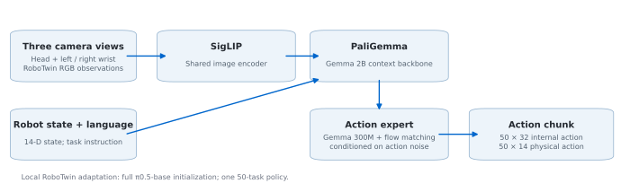
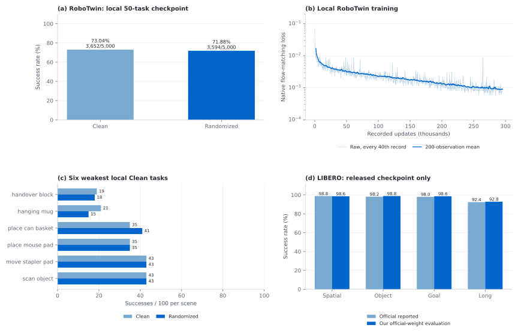

# π0.5: RoboTwin Adaptation and Released-Weight Verification

## π0.5

### Mechanism and Reproduction Boundary

π0.5 combines a PaliGemma vision-language backbone with an action expert that generates continuous action chunks through flow matching [1]. The inspected implementation uses a Gemma 2B context backbone and a Gemma 300M action expert. Images, language and robot state condition the prediction of a velocity field over noisy actions. Our RoboTwin adapter supplies three RGB views and maps 14 physical joint-action channels into the model's 32-dimensional action representation. We inherit the released `pi05_base` parameters and reproduce downstream adaptation; foundation pretraining is outside the measured experiment.

*Figure 1. π0.5 reproduction interfaces. Head and wrist images enter the visual encoder; language and robot state supply additional context. The action expert predicts a 50-step chunk through flow matching, and the adapter selects 14 physical channels from the 32-channel model representation. The diagram describes the local RoboTwin interface; LIBERO uses different observations and chunk settings.*

### Experimental Setup

The local recipe trains one policy across 50 RoboTwin tasks using both Clean and Randomized demonstrations. The training view combines 100 task/scene datasets, containing 27,500 episodes and 6,075,103 frames. Head, left-wrist and right-wrist images are resized to 224 × 224. Fourteen state and action channels are padded to 32; the prediction horizon is 50, and state is discretized for context conditioning. Full fine-tuning uses two H200 NVL GPUs, global batch 16, 295,475 updates, AdamW, 1,000 warmup updates and EMA 0.99. The cosine learning-rate schedule decays from a peak of 2.5e−5 to 2.5e−6. The evaluated checkpoint is the final saved step 295474 under zero-based indexing.

Action-window construction is part of this recipe. We retain only starts whose complete 50-action target remains within the episode, leaving 4,727,603 starts (77.82% of all frame positions). The remaining 1,347,500 starts lie within the final 49 positions of each episode. This avoids repeated terminal actions in the training target while reducing supervision from late-episode observations. The experiment does not isolate the effect of this filtering choice.

**Table 1. π0.5 local RoboTwin adaptation and execution settings.** The released base prior is inherited; all 50 tasks share one downstream checkpoint.

| Setting | Observed configuration |
| --- | --- |
| Initialization / model | Released pi05_base / PaliGemma context and Gemma action expert |
| Training coverage | 50 tasks; Clean + Randomized; 27,500 episodes |
| Input / native representation | Three RGB views; 14 physical state/action channels padded to 32 |
| Image resolution / action horizon | 224 × 224 / 50 |
| Optimizer / local global batch | AdamW / 16 |
| Adaptation / training hardware | 295,475 updates / two H200 NVL GPUs |
| Warmup / peak and terminal LR | 1,000 updates / 2.5e−5 and 2.5e−6 |
| Precision / EMA | BF16 model configuration / 0.99 |
| Completed evaluation | 50 tasks × 100 episodes per scene; Clean and Randomized |
| Execution / rollout allocation | Up to 50 actions per policy request; two GPUs, 16 workers in the full evaluation |

### RoboTwin Success Results

The merged evaluation contains 10,000 valid task/scene episodes: 50 tasks with 100 completed episodes in each scene. The local checkpoint achieves 3,652/5,000 = 73.04% on Clean and 3,594/5,000 = 71.88% on Randomized, giving a two-scene mean of 72.46%. The 1.16-point aggregate difference describes performance on the tested scene distributions. Both distributions contribute training demonstrations, so it does not measure clean-only-to-randomized transfer.

**Table 2. π0.5 closed-loop RoboTwin outcomes.** Each scene contains 5,000 valid episodes; the equal-scene mean equals the pooled success rate because the denominators match.

| Metric | Local final checkpoint |
| --- | ---: |
| Clean successes / episodes | 3,652/5,000 |
| Clean success rate | 73.04% |
| Randomized successes / episodes | 3,594/5,000 |
| Randomized success rate | 71.88% |
| Two-scene successes / episodes | 7,246/10,000 |
| Two-scene mean | 72.46% |

The completed counts combine 6,480 valid original records with 3,520 valid retry records. Original valid episodes are preserved, and unresolved task/scene/episode slots are filled by the first valid retry. Errors and expert-filter or unstable rejections remain outside the completed-rollout denominator. Candidate rejection can change a retry's seed; consequently, the merged set is not a strictly matched-seed reference for a different checkpoint. The evidence appendix retains this selection protocol and the source records. No released RoboTwin-specialist π0.5 checkpoint was evaluated through this adapter, so the available evidence establishes the local result rather than an official-to-local adaptation gap.

### Training Resources and Rollout Runtime

At batch 16, the local run processes 16 × 295,475 = 4,727,600 training windows, approximately one complete-window dataset-sized exposure. This count describes the training budget; it does not establish equal compute or sample exposure with other RoboSeed families. Window contents, inherited priors and execution interfaces also differ across methods. A standardized training-device-time interval has not yet been verified, so no training GPU-hour estimate is assigned.

The RoboTwin evaluation uses two GPUs and 16 rollout workers, followed by retries for unresolved slots. The original and retry jobs have not been consolidated into an audited wall-time total. The separate LIBERO released-weight evaluation completes its two-GPU queue in 3:00:02 (3.001 h). This is workflow time, including simulation and episode scheduling, rather than single-request neural-network latency. Serving p95 and standardized peak-memory traces are unavailable for both experiments.

**Table 3. π0.5 resource observations.** Training exposure is the configured batch multiplied by update count. Missing measurements remain explicit; evaluation wall time is not inference latency.

| Metric | Local RoboTwin run | LIBERO released-weight evaluation |
| --- | --- | --- |
| Training hardware | Two H200 NVL GPUs | No local training |
| Local training exposure | 4,727,600 windows | Not applicable |
| Verified training GPU-hours | — | Not applicable |
| Completed evaluation episodes | 10,000 including retries | 2,000 |
| Evaluation allocation | Two GPUs, 16 workers; retries recorded separately | Two GPUs, one rollout process per GPU |
| Audited evaluation wall time | — | 3:00:02 |
| Serving p95 / standardized peak VRAM | — / — | — / — |

### Training Convergence

The extraction retains 29,548 logged observations at ten-update intervals, from step 0 through 295,470. Native flow-matching loss changes from 0.0721 to 0.0012 over these endpoints. Figure 2b displays every 40th raw observation and a 200-observation moving average, spanning approximately 2,000 updates. The loss decline documents optimization progress under the local objective; the independently evaluated 72.46% two-scene success rate determines the checkpoint's measured task capability. A single loss trajectory cannot identify whether additional exposure, a different chunk sampler or another control setting would improve that rate.

*Figure 2. π0.5 adaptation outcomes and released-weight verification. (a) Local RoboTwin Clean and Randomized outcomes use 5,000 episodes each. (b) Native flow-matching loss uses 29,548 logged observations; light traces retain every 40th record, and the blue curve uses a 200-observation moving average. The logarithmic scale shows within-run optimization, not held-out accuracy or cross-seed uncertainty. (c) The six lowest local Clean tasks are paired with their Randomized counts, with 100 episodes per task and scene. (d) LIBERO compares OpenPI-reported figures with our evaluation of the released pi05_libero checkpoint; no locally trained LIBERO checkpoint is included.*

### Task-Level Profiles and Failure Diagnosis

The small scene-average gap conceals substantial task variation. Block handover obtains 19/100 on Clean and 18/100 on Randomized; mug hanging obtains 21/100 and 15/100. Roller grasping reaches 100/100 in both scenes. These examples locate persistent task-specific weaknesses alongside tasks solved consistently under both scene settings. They do not identify whether perception, contact control, language conditioning or the adaptation budget caused a failure.

**Table 4. Ten lowest local π0.5 Clean tasks.** Each count is out of 100; selection is based on Clean performance. All 50 tasks and both scenes are retained in the accompanying task data.

| Task | Clean | Randomized |
| --- | ---: | ---: |
| handover_block | 19 | 18 |
| hanging_mug | 21 | 15 |
| place_can_basket | 35 | 41 |
| place_mouse_pad | 35 | 35 |
| move_stapler_pad | 43 | 43 |
| scan_object | 43 | 43 |
| place_cans_plasticbox | 47 | 39 |
| place_phone_stand | 48 | 45 |
| blocks_ranking_size | 55 | 59 |
| turn_switch | 55 | 49 |

The current experiment verifies the base-to-adaptation-to-rollout chain for one unified policy. A matched checkpoint evaluation, controlled action-window ablation and systematic failure-trajectory analysis would be needed to attribute the task deficits or quantify the value of a particular design choice. The present score supports a configuration-specific capability assessment, with resource and mechanism evidence still incomplete.

## LIBERO Released-Weight Verification

We evaluate the released `pi05_libero` checkpoint on Spatial, Object, Goal and LIBERO-10, with ten tasks per suite and 50 default initial states per task. The evaluation uses seed 7, agent and wrist views, the checkpoint's normalization assets and a local execution path adapted from OpenPI [1]. Images rendered at 256 × 256 are rotated to match preprocessing and resized/padded to 224 × 224. Following ten settling actions, the policy executes five actions from each predicted ten-action chunk before replanning. Local LIBERO adaptation is absent; this experiment verifies the released checkpoint under the documented evaluator.

**Table 5. Released π0.5-LIBERO checkpoint verification.** OpenPI-reported percentages are reference figures [1]. Local counts are independently collected rollouts using the released checkpoint, with 500 episodes per suite.

| Metric | Spatial | Object | Goal | LIBERO-10 | Average |
| --- | ---: | ---: | ---: | ---: | ---: |
| OpenPI reported (%) | 98.8 | 98.2 | 98.0 | 92.4 | 96.85 |
| Released weights, local (%) | 98.6 | 98.8 | 98.6 | 92.8 | 97.20 |
| Local successes / 500 | 493 | 494 | 493 | 464 | — |

Local success is 1,944/2,000 = 97.20%, 0.35 percentage points above the OpenPI reference. Per-suite differences range from −0.2 to +0.6 points. This agreement supports the released-weight execution check at the reported granularity; one seed does not establish statistical improvement or exact equivalence of implementations. All 2,000 episode identifiers are unique and complete, with no recorded rollout exceptions. In LIBERO-10, placing both moka pots on the stove obtains 30/50, identifying a task for further diagnosis within the 92.80% suite result.

The RoboTwin and LIBERO experiments answer different questions: the former measures a locally adapted policy, while the latter checks a released specialist. Their embodiments, observations, action interfaces and task distributions differ, and the two success rates are not pooled. A local LIBERO checkpoint evaluated through the same execution path is required before drawing an official-to-local training comparison.
