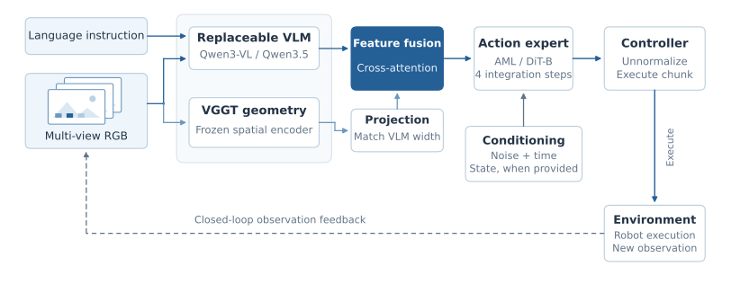

<!-- Generated by scripts/generate_docs.py; edit the source or input data. -->

# ABot-M0 reproduction

[Home](../../../README.md) · [Documentation](../../README.md) · [All experiments](../../experiments/README.md)

RoboSeed reproduces the action formulation of [ABot-M0](https://github.com/amap-cvlab/ABot-Manipulation/tree/ABot-M0) and adapts its VLM backbone interfaces. The method and Action Manifold Learning design are attributed to the [original paper](https://arxiv.org/abs/2602.11236). The `ABot-M0` upstream branch is linked explicitly to keep this record tied to the reproduced model version.

## Architecture and adaptation

The reproduced policy connects VLM semantic features, a frozen VGGT spatial encoder, and a DiT-B action expert. Cross-attention and spatial projection widths are adapted to the VLM hidden dimension. Action/state layouts and executed channels are recorded per benchmark.

*Backbone adaptation, spatial conditioning, action generation, and closed-loop observation feedback. State conditioning applies when supplied by the execution interface.*

## RoboTwin backbone study

| VLM backbone | Clean (%) | Randomized (%) | Average (%) | Training GPU-hours |
| --- | --- | --- | --- | --- |
| [Qwen3.5-0.8B](../../experiments/abot-m0/robotwin/qwen3-5-0-8b.md) | 80.76 | 80.50 | 80.63 | 174.1 |
| [Qwen3-VL-2B](../../experiments/abot-m0/robotwin/qwen3-vl-2b.md) | 83.66 | 83.90 | 83.78 | 214.0 |
| [Qwen3-VL-4B](../../experiments/abot-m0/robotwin/qwen3-vl-4b.md) | 85.70 | 85.34 | 85.52 | 288.1 |
| [Qwen3.5-4B](../../experiments/abot-m0/robotwin/qwen3-5-4b.md) | 85.88 | 85.12 | 85.50 | 394.4 |
| [Qwen3.5-9B](../../experiments/abot-m0/robotwin/qwen3-5-9b.md) | 83.98 | 83.68 | 83.83 | 509.2 |

## Training complete, evaluation pending

| VLM backbone | Post-train updates | Training GPU-hours | Evaluation status |
| --- | --- | --- | --- |
| [Qwen3.5-2B](../../experiments/abot-m0/robotwin/qwen3-5-2b.md) | 150,000 | 212.9 | Pending at the report snapshot |

## Dataset-specific policies

| Benchmark | Post-train updates | Evaluation counts | Result |
| --- | --- | --- | --- |
| [LIBERO](../../experiments/abot-m0/libero/qwen3-5-4b.md) | 40k | 1,935/2,000 | 96.75% |
| [LIBERO-plus](../../experiments/abot-m0/liberoplus/qwen3-5-4b.md) | No extra training | 8,027/10,030 | 80.03% |
| [RoboCasa GR1 Tabletop](../../experiments/abot-m0/robocasa-tabletop/qwen3-5-4b.md) | 50k | 574/1,200 | 47.83% |
| [CALVIN · ABCD → D](../../experiments/abot-m0/calvin/qwen3-5-4b.md) | 34k | 1,000 five-task sequences | Mean length **3.625 / 5**; five tasks **57.1%** |

[Experimental findings and interpretation](../../findings/README.md)

## Earlier pre-train → post-train reproduction

[Separate 500-episode diagnostic record](../../experiments/abot-m0/robotwin/pre-train-to-post-train-diagnostic.md)
