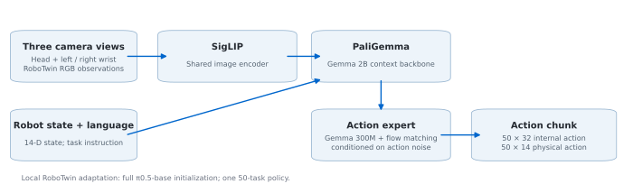

<!-- Generated by scripts/generate_docs.py; edit the source or input data. -->

# π0.5

[Home](../../../README.md) · [Documentation](../../README.md) · [All experiments](../../experiments/README.md)

π0.5 uses a PaliGemma context backbone and a Gemma action expert with flow matching. RoboSeed adds a local 50-task RoboTwin post-train run and a separate verification of the released LIBERO checkpoint. Inherited base pre-train, local downstream adaptation and released-weight evaluation remain distinct.

*π0.5 local RoboTwin reproduction interfaces.*

| Experiment | Checkpoint origin | Completed result |
| --- | --- | --- |
| [RoboTwin](../../experiments/pi05/robotwin/README.md) | Local post-train from pi05_base | Clean 73.04%; Randomized 71.88%; mean 72.46%; 10,000 episodes |
| [LIBERO](../../experiments/pi05/libero/README.md) | Released pi05_libero evaluated locally | 1,944/2,000 (97.20%) |

Local LIBERO post-train and DROID experiments are not completed. The additional results are outside the historical twelve-checkpoint assessment profiles; no unmeasured resource scores or local weight-download URL is assigned.

[Evidence, configs and audit](../../../data/pi05/README.md)
