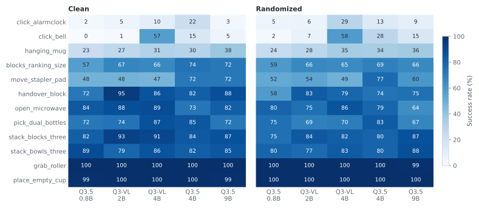

<!-- Generated by scripts/generate_docs.py; edit the source or input data. -->

# RoboTwin 2.0

[Home](../../../README.md) · [Documentation](../../README.md) · [All experiments](../../experiments/README.md)

Bimanual manipulation under Clean and Randomized scenes. Our post-train data contain both scene types; each completed backbone has 5,000 evaluation episodes per scene.

[Official benchmark](https://robotwin-platform.github.io/)

Direct downstream **post-train**, without the unified robotic **pre-train** stage. Training includes Clean and Randomized demonstrations: the records report 27,500 trajectories and 6,075,103 transitions. All runs use four H200 NVL GPUs, 150,000 updates, global batch 64 (16 per device; accumulation 1), seed 42, and 224 × 224 images. VGGT is frozen. The DiT-B expert uses action horizon 50, configured state/action dimensions 14/14, and four repeated time samples. Base/VLM/action learning rates are 1e-5 / 1e-5 / 1e-4; AdamW uses betas (0.9, 0.95), 5,000 warmup steps, and cosine decay to 5e-7.

Evaluation uses 50 tasks × 100 episodes for each of `demo_clean` and `demo_randomized`, launch seed 0, and unseen instructions. The recorded evaluator commit is `13c3c47`, with local interface and frame-sampling modifications. Binary environment success is used. Training includes randomized trajectories, so Randomized results do not establish generalization from Clean-only training.

## Completed backbone evaluations

| VLM backbone | Clean (%) | Randomized (%) | Average (%) | Training GPU-hours | Weights |
| --- | --- | --- | --- | --- | --- |
| [Qwen3.5-0.8B](../../experiments/abot-m0/robotwin/qwen3-5-0-8b.md) | 80.76 | 80.50 | 80.63 | 174.1 | [ModelScope](https://www.modelscope.cn/models/InPeerReview/RoboSeed/tree/master/models/RoboSeed-ABot-M0-RoboTwin-Qwen3.5-0.8B) |
| [Qwen3-VL-2B](../../experiments/abot-m0/robotwin/qwen3-vl-2b.md) | 83.66 | 83.90 | 83.78 | 214.0 | [ModelScope](https://www.modelscope.cn/models/InPeerReview/RoboSeed/tree/master/models/RoboSeed-ABot-M0-RoboTwin-Qwen3-VL-2B) |
| [Qwen3-VL-4B](../../experiments/abot-m0/robotwin/qwen3-vl-4b.md) | 85.70 | 85.34 | 85.52 | 288.1 | [ModelScope](https://www.modelscope.cn/models/InPeerReview/RoboSeed/tree/master/models/RoboSeed-ABot-M0-RoboTwin-Qwen3-VL-4B) |
| [Qwen3.5-2B](../../experiments/abot-m0/robotwin/qwen3-5-2b.md) | 84.30 | 83.94 | 84.12 | 212.9 | [ModelScope](https://www.modelscope.cn/models/InPeerReview/RoboSeed/tree/master/models/RoboSeed-ABot-M0-RoboTwin-Qwen3.5-2B) |
| [Qwen3.5-4B](../../experiments/abot-m0/robotwin/qwen3-5-4b.md) | 85.88 | 85.12 | 85.50 | 394.4 | [ModelScope](https://www.modelscope.cn/models/InPeerReview/RoboSeed/tree/master/models/RoboSeed-ABot-M0-RoboTwin-Qwen3.5-4B) |
| [Qwen3.5-9B](../../experiments/abot-m0/robotwin/qwen3-5-9b.md) | 83.98 | 83.68 | 83.83 | 509.2 | [ModelScope](https://www.modelscope.cn/models/InPeerReview/RoboSeed/tree/master/models/RoboSeed-ABot-M0-RoboTwin-Qwen3.5-9B) |

[Complete 600 ABot scene/task rows](task_results.md)

*Selected task profiles across six backbones; full counts are available in the linked task table.*

## Additional reproduced models

| Checkpoint | Clean successes / episodes | Randomized successes / episodes | Local training GPU-hours | Weights |
| --- | --- | --- | --- | --- |
| [LingBot 6B official](../../experiments/lingbot-vla2/robotwin/README.md) | 4,486/5,000 (89.72%) | — | — | [ModelScope](https://www.modelscope.cn/models/InPeerReview/RoboSeed/tree/master/models/RoboSeed-LingBot-VLA2-6B-RoboTwin-official-step50000) |
| [LingBot 6B local](../../experiments/lingbot-vla2/robotwin/README.md) | 2,889/5,000 (57.78%) | — | 174.365 | [ModelScope](https://www.modelscope.cn/models/InPeerReview/RoboSeed/tree/master/models/RoboSeed-LingBot-VLA2-6B-RoboTwin-local-step50000) |
| [OpenWAM official](../../experiments/openwam/robotwin/README.md) | 4,701/5,000 (94.02%) | 4,683/5,000 (93.66%) | — | [ModelScope](https://www.modelscope.cn/models/InPeerReview/RoboSeed/tree/master/models/RoboSeed-OpenWAM-Alpha-RoboTwin-official-step118655) |
| [OpenWAM local](../../experiments/openwam/robotwin/README.md) | 4,565/5,000 (91.30%) | 4,570/5,000 (91.40%) | 262.068 | [ModelScope](https://www.modelscope.cn/models/InPeerReview/RoboSeed/tree/master/models/RoboSeed-OpenWAM-Alpha-RoboTwin-local-step80000) |
| [LiLa-WAM official](../../experiments/lila-wam/robotwin/README.md) | 224/250 (89.60%) | — | — | [ModelScope](https://www.modelscope.cn/models/InPeerReview/RoboSeed/tree/master/models/RoboSeed-LiLa-WAM-RoboTwin-official-stage2-epoch4) |
| [LiLa-WAM local](../../experiments/lila-wam/robotwin/README.md) | 222/250 (88.80%) | — | — | [ModelScope](https://www.modelscope.cn/models/InPeerReview/RoboSeed/tree/master/models/RoboSeed-LiLa-WAM-RoboTwin-local-stage2-epoch4) |

[PX harness systems results](../../experiments/px-harness/README.md) · [Five-dimension evaluation framework](../../findings/assessment.md)
