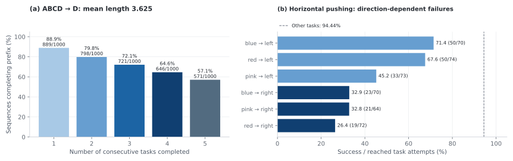
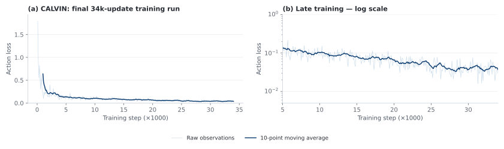

<!-- Generated by scripts/generate_docs.py; edit the source or input data. -->

# ABot-M0 × Qwen3.5-4B · CALVIN

[Home](../../../../README.md) · [Documentation](../../../README.md) · [All experiments](../../README.md)

**Experimental objective.** RoboSeed studies model behavior under practical, limited-hardware training budgets, using the ABot-M0 downstream study as the comparison reference. Some official training recipes require resources beyond this setting, so local runs adapt their batch sizes, training durations and execution settings to the available hardware. The goal is to compare models at comparable downstream training scales. The recorded runs below retain their actual budgets; batch size, updates, sample exposure and compute are not all equal across families. A local score below a released checkpoint therefore describes this budget-adapted recipe and does not establish that the original method is weaker.

[Comparison scope and actual training budgets](../../../reproduction/comparison-protocol.md)

## Training and execution

**ABCD training → D evaluation. Environment D is included in training.** The converted LeRobot v2.1 dataset has 17,870 demonstrations and 1,071,743 frames. The final run uses 34k post-train updates, global batch 64, seed 42, four H200 GPUs, and frozen VGGT. The DiT-B action expert has 16 layers and four configured integration steps. Training and executed action horizons are both eight in the inspected client. Configured state/action dimensions are 16/14; execution selects seven right-arm channels for relative end-effector translation, rotation, and gripper control.

The policy receives static and wrist camera observations plus language, with no explicit robot-state field in the inspected request. The evaluator runs 1,000 five-instruction sequences, preserves the physical state within each chain, and stops at the first failed instruction. Each subtask has a 360-step limit. The inspected client executes eight actions despite the wrapper setting `replan_steps=5`.

| Resource | Observed value |
| --- | --- |
| Updates | 34000 |
| Training wall time | 14:39:51 |
| Training GPU-hours | 58.66 |
| Training throughput | 41.22 samples/s |
| Checkpoint bytes | 13270910352 |
| Recorded evaluation wall time | Approximately 10 h 16 min |
| Final action loss | 0.02949 |

[Recorded configuration](../../../../configs/abot-m0/calvin-qwen3-5-4b.yaml)

## Chain completion

**Mean successful prefix: 3.625 / 5. Fully completed sequences: 571/1000 (57.1%).**

| Consecutive tasks completed | Sequences / 1,000 | Completion (%) |
| --- | --- | --- |
| 1 | 889 | 88.9 |
| 2 | 798 | 79.8 |
| 3 | 721 | 72.1 |
| 4 | 646 | 64.6 |
| 5 | 571 | 57.1 |

*Sequence completion uses all 1,000 chains; horizontal-pushing rates use only reached task attempts.*

## Conditional task outcomes

There are **3,625 successful subtasks in 4,054 reached attempts**, over 34 unique task types. A task is observed only when its preceding instructions succeed. Conditional task percentages are not averaged into mean chain length. The six horizontal-pushing tasks achieve 196/423 (46.34%), compared with 3,429/3,631 (94.44%) for the remaining task types. `push_into_drawer` is not included in the horizontal-pushing group.

| Task | Successes / reached attempts | Success (%) |
| --- | --- | --- |
| close_drawer | 182/182 | 100.00 |
| lift_blue_block_drawer | 19/19 | 100.00 |
| lift_blue_block_slider | 100/123 | 81.30 |
| lift_blue_block_table | 143/143 | 100.00 |
| lift_pink_block_drawer | 11/11 | 100.00 |
| lift_pink_block_slider | 109/128 | 85.16 |
| lift_pink_block_table | 120/129 | 93.02 |
| lift_red_block_drawer | 17/17 | 100.00 |
| lift_red_block_slider | 106/122 | 86.89 |
| lift_red_block_table | 153/155 | 98.71 |
| move_slider_left | 231/233 | 99.14 |
| move_slider_right | 252/252 | 100.00 |
| open_drawer | 307/320 | 95.94 |
| place_in_drawer | 147/151 | 97.35 |
| place_in_slider | 258/298 | 86.58 |
| push_blue_block_left | 50/70 | 71.43 |
| push_blue_block_right | 23/70 | 32.86 |
| push_into_drawer | 88/102 | 86.27 |
| push_pink_block_left | 33/73 | 45.21 |
| push_pink_block_right | 21/64 | 32.81 |
| push_red_block_left | 50/74 | 67.57 |
| push_red_block_right | 19/72 | 26.39 |
| rotate_blue_block_left | 66/66 | 100.00 |
| rotate_blue_block_right | 70/77 | 90.91 |
| rotate_pink_block_left | 54/55 | 98.18 |
| rotate_pink_block_right | 45/68 | 66.18 |
| rotate_red_block_left | 60/61 | 98.36 |
| rotate_red_block_right | 69/72 | 95.83 |
| stack_block | 153/165 | 92.73 |
| turn_off_led | 138/150 | 92.00 |
| turn_off_lightbulb | 134/135 | 99.26 |
| turn_on_led | 168/168 | 100.00 |
| turn_on_lightbulb | 164/164 | 100.00 |
| unstack_block | 65/65 | 100.00 |

## Training and source audit

*All 340 observations from the final uninterrupted 34k-update run; nine preliminary observations are excluded and retained in the audit count.*

The source JSON contains two top-level `0` keys. The final occurrence is the 1,000-sequence result; the earlier ten-sequence smoke test is retained in the audit and is not pooled. The available aggregate outcomes do not provide independent per-sequence execution traces. The saved minimum learning rate is 1e-6 while the final logged scalar is 4e-7; scheduler/parameter-group conventions remain unresolved.

[Chain CSV](../../../../data/calvin_chain.csv) · [Task CSV](../../../../data/calvin_tasks.csv) · [Loss CSV](../../../../data/calvin_loss.csv) · [Source JSON](../../../../data/calvin_results_source.json) · [Duplicate-key audit](../../../../data/calvin_audit.json) · [Input sequence list](../../../../data/calvin_eval_sequences.json)

## Model weights

[Download from ModelScope](https://www.modelscope.cn/models/InPeerReview/RoboSeed/tree/master/models/RoboSeed-ABot-M0-CALVIN-Qwen3.5-4B) · [Package registry and dependencies](../../../releases/README.md)
