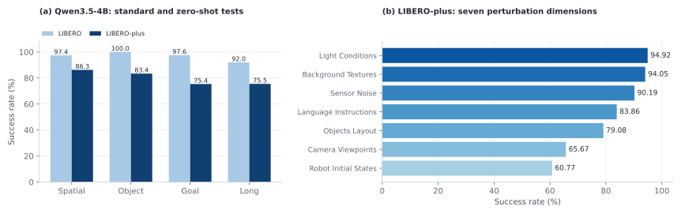

<!-- Generated by scripts/generate_docs.py; edit the source or input data. -->

# ABot-M0 × Qwen3.5-4B · LIBERO

[Home](../../../../README.md) · [Documentation](../../../README.md) · [All experiments](../../README.md)

## Training and evaluation

Independently trained LIBERO policy, selected `steps_40000` checkpoint. 40k post-train updates, global batch 64; base/VLM/action learning rates 2.5e-5 / 3e-5 / 1e-4. VGGT is frozen; action horizon 10, configured state dimension 7, internal action dimension 14, and seven active Franka channels. The saved script specifies `include_state=false`; its effective training behavior requires the corresponding implementation version.

Evaluation covers four suites of ten tasks, with 50 episodes per task. Counts are reconstructed from success/failure markers in video filenames. Exact immutable evaluator revision and seed are not established by the packaged counts.

[Recorded configuration](../../../../configs/abot-m0/libero-qwen3-5-4b.yaml) · [40-task CSV](../../../../data/libero_tasks.csv)

## Outcomes

| Suite | Successes / episodes | Success (%) |
| --- | --- | --- |
| libero_spatial | 487/500 | 97.40 |
| libero_object | 500/500 | 100.00 |
| libero_goal | 488/500 | 97.60 |
| libero_10 | 460/500 | 92.00 |
| Overall | 1935/2000 | 96.75 |

*Standard LIBERO and zero-shot LIBERO-plus, with separate suite and perturbation denominators.*

[All LIBERO task counts](../../../datasets/libero/task_results.md) · [LIBERO-plus evaluation of this checkpoint](../liberoplus/qwen3-5-4b.md)
