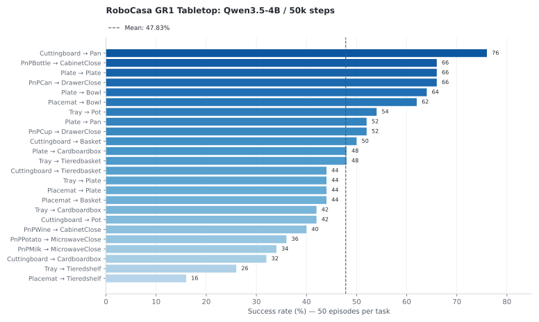

<!-- Generated by scripts/generate_docs.py; edit the source or input data. -->

# ABot-M0 × Qwen3.5-4B · RoboCasa GR1 Tabletop

[Home](../../../../README.md) · [Documentation](../../../README.md) · [All experiments](../../README.md)

**Experimental objective.** RoboSeed studies model behavior under practical, limited-hardware training budgets, using the ABot-M0 downstream study as the comparison reference. Some official training recipes require resources beyond this setting, so local runs adapt their batch sizes, training durations and execution settings to the available hardware. The goal is to compare models at comparable downstream training scales. The recorded runs below retain their actual budgets; batch size, updates, sample exposure and compute are not all equal across families. A local score below a released checkpoint therefore describes this budget-adapted recipe and does not establish that the original method is weaker.

[Comparison scope and actual training budgets](../../../reproduction/comparison-protocol.md)

## Training and execution

Independently trained `steps_50000` policy. The training mix covers 24 datasets with 1,000 demonstrations each. 50k post-train updates, global batch 64, four H200 GPUs; base/VLM/action learning rates 1e-5 / 1e-5 / 1e-4. VGGT is frozen. Training horizon is 16; 58 state dimensions encode sine and cosine of 29 joint values. The policy outputs 29 absolute joint targets for the arms, dexterous hands, and waist. The recorded training time is approximately 20 h 44 min; the corresponding cost is approximately 82.9 GPU-hours.

Rollouts use 24 tasks × 50 episodes, a 720-step limit, and 12 executed actions per chunk. Counts are reconstructed from video filename verdicts, preserving UUID-based episode identifiers. A matched causal ablation of individual failure sources is not available.

## Outcomes

**574/1,200 episodes succeed (47.83%).**

[Recorded configuration](../../../../configs/abot-m0/robocasa-tabletop-qwen3-5-4b.yaml) · [All task CSV rows](../../../../data/robocasa_tasks.csv)

*Success varies across 24 GR1 Tabletop tasks; the dashed reference is the episode-level mean.*

| Task | Successes / episodes | Success (%) |
| --- | --- | --- |
| PosttrainPnPNovelFromTrayToTieredshelfSplitA | 13/50 | 26.00 |
| PosttrainPnPNovelFromPlacematToBowlSplitA | 31/50 | 62.00 |
| PosttrainPnPNovelFromCuttingboardToBasketSplitA | 25/50 | 50.00 |
| PosttrainPnPNovelFromTrayToTieredbasketSplitA | 24/50 | 48.00 |
| PnPMilkToMicrowaveClose | 17/50 | 34.00 |
| PnPCupToDrawerClose | 26/50 | 52.00 |
| PosttrainPnPNovelFromCuttingboardToCardboardboxSplitA | 16/50 | 32.00 |
| PosttrainPnPNovelFromPlacematToBasketSplitA | 22/50 | 44.00 |
| PnPPotatoToMicrowaveClose | 18/50 | 36.00 |
| PosttrainPnPNovelFromPlacematToPlateSplitA | 22/50 | 44.00 |
| PosttrainPnPNovelFromTrayToPlateSplitA | 22/50 | 44.00 |
| PnPWineToCabinetClose | 20/50 | 40.00 |
| PosttrainPnPNovelFromPlateToPanSplitA | 26/50 | 52.00 |
| PnPCanToDrawerClose | 33/50 | 66.00 |
| PosttrainPnPNovelFromCuttingboardToPanSplitA | 38/50 | 76.00 |
| PosttrainPnPNovelFromPlacematToTieredshelfSplitA | 8/50 | 16.00 |
| PosttrainPnPNovelFromPlateToCardboardboxSplitA | 24/50 | 48.00 |
| PosttrainPnPNovelFromCuttingboardToPotSplitA | 21/50 | 42.00 |
| PosttrainPnPNovelFromPlateToPlateSplitA | 33/50 | 66.00 |
| PosttrainPnPNovelFromPlateToBowlSplitA | 32/50 | 64.00 |
| PnPBottleToCabinetClose | 33/50 | 66.00 |
| PosttrainPnPNovelFromCuttingboardToTieredbasketSplitA | 22/50 | 44.00 |
| PosttrainPnPNovelFromTrayToCardboardboxSplitA | 21/50 | 42.00 |
| PosttrainPnPNovelFromTrayToPotSplitA | 27/50 | 54.00 |

## Model weights

[Download from ModelScope](https://www.modelscope.cn/models/InPeerReview/RoboSeed/tree/master/models/RoboSeed-ABot-M0-RoboCasa-Qwen3.5-4B) · [Package registry and dependencies](../../../releases/README.md)
