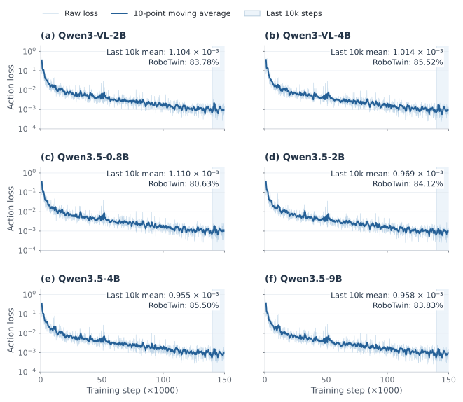

<!-- Generated by scripts/generate_docs.py; edit the source or input data. -->

# ABot-M0 × Qwen3.5-2B · RoboTwin

[Home](../../../../README.md) · [Documentation](../../../README.md) · [All experiments](../../README.md)

**Experimental objective.** RoboSeed studies model behavior under practical, limited-hardware training budgets, using the ABot-M0 downstream study as the comparison reference. Some official training recipes require resources beyond this setting, so local runs adapt their batch sizes, training durations and execution settings to the available hardware. The goal is to compare models at comparable downstream training scales. The recorded runs below retain their actual budgets; batch size, updates, sample exposure and compute are not all equal across families. A local score below a released checkpoint therefore describes this budget-adapted recipe and does not establish that the original method is weaker.

[Comparison scope and actual training budgets](../../../reproduction/comparison-protocol.md)

## Training and execution

Direct downstream **post-train**, without the unified robotic **pre-train** stage. Training includes Clean and Randomized demonstrations: the records report 27,500 trajectories and 6,075,103 transitions. All runs use four H200 NVL GPUs, 150,000 updates, global batch 64 (16 per device; accumulation 1), seed 42, and 224 × 224 images. VGGT is frozen. The DiT-B expert uses action horizon 50, configured state/action dimensions 14/14, and four repeated time samples. Base/VLM/action learning rates are 1e-5 / 1e-5 / 1e-4; AdamW uses betas (0.9, 0.95), 5,000 warmup steps, and cosine decay to 5e-7.

Evaluation uses 50 tasks × 100 episodes for each of `demo_clean` and `demo_randomized`, launch seed 0, and unseen instructions. The recorded evaluator commit is `13c3c47`, with local interface and frame-sampling modifications. Binary environment success is used. Training includes randomized trajectories, so Randomized results do not establish generalization from Clean-only training.

[Recorded configuration](../../../../configs/abot-m0/robotwin-qwen3-5-2b.yaml) · [Checkpoint status](../../../releases/README.md)

| Resource | Observed value |
| --- | --- |
| Training wall time | 53:13:34 |
| Training GPU-hours | 212.90 |
| Training throughput | 50.10 samples/s |
| Recorded mean / peak GPU memory | 58.95 / 71.01 GiB |
| Checkpoint size | 8.332 GB (decimal) |

Memory values are approximate readings from the experiment record, rather than a standardized minimum-memory profile. Training GPU-hours exclude rollout time.

The report flags the Qwen3.5 memory readings for reconciliation with monitoring units and device capacity. Software and shared-host conditions differ between runs, so observed memory ordering does not establish a scaling rule.

Rollouts use four evaluation GPUs and at most 6 workers per GPU. Scene runtimes are workflow wall times and may overlap; they are not measurements of single-request policy latency. Evaluation videos were disabled for the RoboTwin series.

## Outcomes

| Scene | Successes / episodes | Success (%) | Recorded rollout hours |
| --- | --- | --- | --- |
| Clean | 4215/5000 | 84.30 | 4.42 |
| Randomized | 4197/5000 | 83.94 | 9.10 |
| Two-scene average | Equal scene weighting | 84.12 | Reported separately above |

[Task CSV](qwen3-5-2b-task-results.csv)

All 50 tasks · Clean and Randomized

| suite | Task | Successes / episodes | Success (%) |
| --- | --- | --- | --- |
| Clean | adjust_bottle | 100/100 | 100.00 |
| Randomized | adjust_bottle | 99/100 | 99.00 |
| Clean | beat_block_hammer | 86/100 | 86.00 |
| Randomized | beat_block_hammer | 83/100 | 83.00 |
| Clean | blocks_ranking_rgb | 90/100 | 90.00 |
| Randomized | blocks_ranking_rgb | 84/100 | 84.00 |
| Clean | blocks_ranking_size | 54/100 | 54.00 |
| Randomized | blocks_ranking_size | 74/100 | 74.00 |
| Clean | click_alarmclock | 6/100 | 6.00 |
| Randomized | click_alarmclock | 15/100 | 15.00 |
| Clean | click_bell | 20/100 | 20.00 |
| Randomized | click_bell | 12/100 | 12.00 |
| Clean | dump_bin_bigbin | 97/100 | 97.00 |
| Randomized | dump_bin_bigbin | 96/100 | 96.00 |
| Clean | grab_roller | 100/100 | 100.00 |
| Randomized | grab_roller | 100/100 | 100.00 |
| Clean | handover_block | 85/100 | 85.00 |
| Randomized | handover_block | 85/100 | 85.00 |
| Clean | handover_mic | 100/100 | 100.00 |
| Randomized | handover_mic | 100/100 | 100.00 |
| Clean | hanging_mug | 28/100 | 28.00 |
| Randomized | hanging_mug | 36/100 | 36.00 |
| Clean | lift_pot | 100/100 | 100.00 |
| Randomized | lift_pot | 99/100 | 99.00 |
| Clean | move_can_pot | 82/100 | 82.00 |
| Randomized | move_can_pot | 84/100 | 84.00 |
| Clean | move_pillbottle_pad | 94/100 | 94.00 |
| Randomized | move_pillbottle_pad | 92/100 | 92.00 |
| Clean | move_playingcard_away | 99/100 | 99.00 |
| Randomized | move_playingcard_away | 98/100 | 98.00 |
| Clean | move_stapler_pad | 76/100 | 76.00 |
| Randomized | move_stapler_pad | 73/100 | 73.00 |
| Clean | open_laptop | 95/100 | 95.00 |
| Randomized | open_laptop | 100/100 | 100.00 |
| Clean | open_microwave | 79/100 | 79.00 |
| Randomized | open_microwave | 81/100 | 81.00 |
| Clean | pick_diverse_bottles | 65/100 | 65.00 |
| Randomized | pick_diverse_bottles | 69/100 | 69.00 |
| Clean | pick_dual_bottles | 68/100 | 68.00 |
| Randomized | pick_dual_bottles | 72/100 | 72.00 |
| Clean | place_a2b_left | 92/100 | 92.00 |
| Randomized | place_a2b_left | 93/100 | 93.00 |
| Clean | place_a2b_right | 90/100 | 90.00 |
| Randomized | place_a2b_right | 91/100 | 91.00 |
| Clean | place_bread_basket | 86/100 | 86.00 |
| Randomized | place_bread_basket | 85/100 | 85.00 |
| Clean | place_bread_skillet | 89/100 | 89.00 |
| Randomized | place_bread_skillet | 77/100 | 77.00 |
| Clean | place_burger_fries | 100/100 | 100.00 |
| Randomized | place_burger_fries | 100/100 | 100.00 |
| Clean | place_can_basket | 73/100 | 73.00 |
| Randomized | place_can_basket | 77/100 | 77.00 |
| Clean | place_cans_plasticbox | 100/100 | 100.00 |
| Randomized | place_cans_plasticbox | 97/100 | 97.00 |
| Clean | place_container_plate | 100/100 | 100.00 |
| Randomized | place_container_plate | 100/100 | 100.00 |
| Clean | place_dual_shoes | 91/100 | 91.00 |
| Randomized | place_dual_shoes | 83/100 | 83.00 |
| Clean | place_empty_cup | 99/100 | 99.00 |
| Randomized | place_empty_cup | 99/100 | 99.00 |
| Clean | place_fan | 93/100 | 93.00 |
| Randomized | place_fan | 92/100 | 92.00 |
| Clean | place_mouse_pad | 77/100 | 77.00 |
| Randomized | place_mouse_pad | 77/100 | 77.00 |
| Clean | place_object_basket | 97/100 | 97.00 |
| Randomized | place_object_basket | 86/100 | 86.00 |
| Clean | place_object_scale | 96/100 | 96.00 |
| Randomized | place_object_scale | 86/100 | 86.00 |
| Clean | place_object_stand | 94/100 | 94.00 |
| Randomized | place_object_stand | 91/100 | 91.00 |
| Clean | place_phone_stand | 91/100 | 91.00 |
| Randomized | place_phone_stand | 95/100 | 95.00 |
| Clean | place_shoe | 91/100 | 91.00 |
| Randomized | place_shoe | 100/100 | 100.00 |
| Clean | press_stapler | 95/100 | 95.00 |
| Randomized | press_stapler | 93/100 | 93.00 |
| Clean | put_bottles_dustbin | 82/100 | 82.00 |
| Randomized | put_bottles_dustbin | 74/100 | 74.00 |
| Clean | put_object_cabinet | 92/100 | 92.00 |
| Randomized | put_object_cabinet | 86/100 | 86.00 |
| Clean | rotate_qrcode | 84/100 | 84.00 |
| Randomized | rotate_qrcode | 88/100 | 88.00 |
| Clean | scan_object | 83/100 | 83.00 |
| Randomized | scan_object | 81/100 | 81.00 |
| Clean | shake_bottle | 100/100 | 100.00 |
| Randomized | shake_bottle | 98/100 | 98.00 |
| Clean | shake_bottle_horizontally | 99/100 | 99.00 |
| Randomized | shake_bottle_horizontally | 99/100 | 99.00 |
| Clean | stack_blocks_three | 84/100 | 84.00 |
| Randomized | stack_blocks_three | 81/100 | 81.00 |
| Clean | stack_blocks_two | 95/100 | 95.00 |
| Randomized | stack_blocks_two | 96/100 | 96.00 |
| Clean | stack_bowls_three | 85/100 | 85.00 |
| Randomized | stack_bowls_three | 78/100 | 78.00 |
| Clean | stack_bowls_two | 98/100 | 98.00 |
| Randomized | stack_bowls_two | 96/100 | 96.00 |
| Clean | stamp_seal | 68/100 | 68.00 |
| Randomized | stamp_seal | 78/100 | 78.00 |
| Clean | turn_switch | 67/100 | 67.00 |
| Randomized | turn_switch | 68/100 | 68.00 |

## Loss observations

*One panel per backbone; identical step and loss axes. Thin traces show raw observations and thick traces show a ten-point moving average. Tail means and rollout scores are annotated separately.*

[Raw loss CSV](../../../../data/robotwin_loss.csv) · [RoboTwin dataset and full comparison](../../../datasets/robotwin/README.md)

[How to interpret scale, loss, and cost](../../../findings/README.md)

## Model weights

[Download from ModelScope](https://www.modelscope.cn/models/InPeerReview/RoboSeed/tree/master/models/RoboSeed-ABot-M0-RoboTwin-Qwen3.5-2B) · [Package registry and dependencies](../../../releases/README.md)
