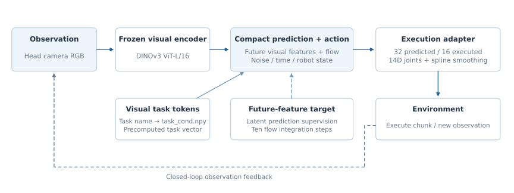
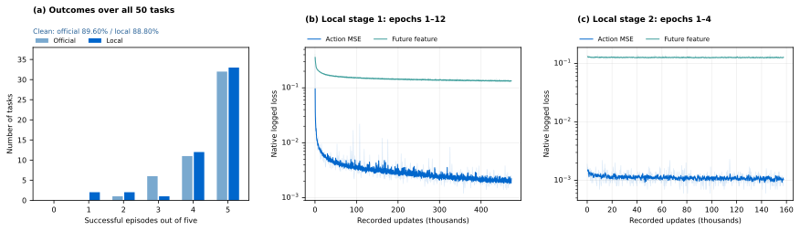

<!-- Generated by scripts/generate_docs.py; edit the source or input data. -->

# LiLa-WAM · RoboTwin

[Home](../../../../README.md) · [Documentation](../../../README.md) · [All experiments](../../README.md)

[Original paper](https://arxiv.org/abs/2608.03701) · [Technical report](../../../report/README.md)

## Setup and inherited components

Frozen DINOv3 ViT-L/16 with compact future-feature prediction and action generation. Head camera at 320 × 240, 14 joint-action channels, 32 predicted actions, first 16 executed, ten flow steps and spline smoothing. The local evaluated artifact is stage-2 epoch four.

*LiLa-WAM architecture and reproduction interfaces.*

## Evaluation protocol

Clean only, 50 tasks × five episodes on one H200 NVL with four workers. A task name selects precomputed visual transition tokens (task_cond.npy); the inspected policy ignores the instruction argument. These outcomes do not demonstrate unseen-language understanding.

| Checkpoint | Clean successes / episodes | Randomized successes / episodes | Local training GPU-hours | Weights |
| --- | --- | --- | --- | --- |
| [LiLa-WAM official](README.md) | 224/250 (89.60%) | — | — | [ModelScope](https://www.modelscope.cn/models/InPeerReview/RoboSeed/tree/master/models/RoboSeed-LiLa-WAM-RoboTwin-official-stage2-epoch4) |
| [LiLa-WAM local](README.md) | 222/250 (88.80%) | — | — | [ModelScope](https://www.modelscope.cn/models/InPeerReview/RoboSeed/tree/master/models/RoboSeed-LiLa-WAM-RoboTwin-local-stage2-epoch4) |

## Interpretation and measured cost

Official and local checkpoints achieve 224/250 (89.60%) and 222/250 (88.80%). The difference is two successful episodes; five episodes per task do not establish equivalence. Randomized outcomes and independently verified H200 adaptation cost are unavailable. The approximately 1.273 GB package excludes the separately loaded DINOv3 encoder and may contain optimizer state, so it is not the complete deployment footprint.

*LiLa-WAM checkpoint outcomes, native training losses, task profiles and recorded resources.*

## Evidence and downloads

[lila_stage1_training_observations.csv](../../../../data/lila_stage1_training_observations.csv) · [lila_stage2_training_observations.csv](../../../../data/lila_stage2_training_observations.csv)

[All task counts](task_results.md) · [Checkpoint registry and package dependencies](../../../releases/README.md)

Each ModelScope folder contains its model card, available configuration and normalization assets. Follow that card for the compatible method implementation and external encoders. The branch `master` is mutable; the package registry records observed weight hashes.
