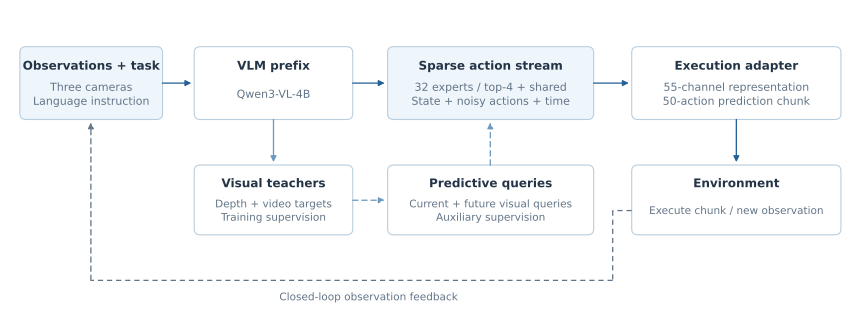
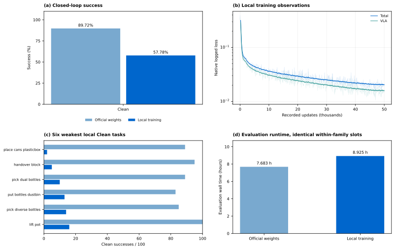

<!-- Generated by scripts/generate_docs.py; edit the source or input data. -->

# LingBot-VLA 2.0 · RoboTwin

[Home](../../../../README.md) · [Documentation](../../../README.md) · [All experiments](../../README.md)

[Original paper](https://arxiv.org/abs/2607.06403) · [Technical report](../../../report/README.md)

## Setup and inherited components

Qwen3-VL-4B with 32 routed action experts (top-4 plus a shared expert) and depth/video teacher supervision. Local adaptation inherits the released foundation: Muon, three H200 GPUs, global batch 96, 50k updates, 55 state/action channels, three cameras, chunk length 50 and ten inference steps.

*LingBot-VLA 2.0 architecture and reproduction interfaces.*

## Evaluation protocol

Clean only, 50 tasks × 100 episodes, unseen instructions, seed 0, BF16 and compilation; four GPUs with three rollout slots each. Randomized evaluation is unavailable.

| Checkpoint | Clean successes / episodes | Randomized successes / episodes | Local training GPU-hours | Weights |
| --- | --- | --- | --- | --- |
| [LingBot 6B official](README.md) | 4,486/5,000 (89.72%) | — | — | [ModelScope](https://www.modelscope.cn/models/InPeerReview/RoboSeed/tree/master/models/RoboSeed-LingBot-VLA2-6B-RoboTwin-official-step50000) |
| [LingBot 6B local](README.md) | 2,889/5,000 (57.78%) | — | 174.365 | [ModelScope](https://www.modelscope.cn/models/InPeerReview/RoboSeed/tree/master/models/RoboSeed-LingBot-VLA2-6B-RoboTwin-local-step50000) |

## Interpretation and measured cost

The local checkpoint is 31.94 percentage points below the official checkpoint on the common local evaluator. Local exposure is 4.8M windows versus 51.2M in the source recipe. This supports a recipe-sensitivity diagnosis; it does not isolate exposure, teacher supervision or MoE as the cause. The measured local training interval is 174.365 H200 GPU-hours, excluding setup and final export.

*LingBot-VLA 2.0 checkpoint outcomes, native training losses, task profiles and recorded resources.*

## Evidence and downloads

[ling_training_observations.csv](../../../../data/ling_training_observations.csv)

[All task counts](task_results.md) · [Checkpoint registry and package dependencies](../../../releases/README.md)

Each ModelScope folder contains its model card, available configuration and normalization assets. Follow that card for the compatible method implementation and external encoders. The branch `master` is mutable; the package registry records observed weight hashes.
