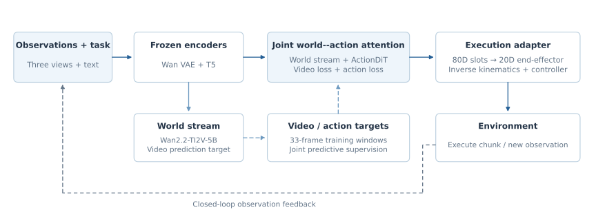
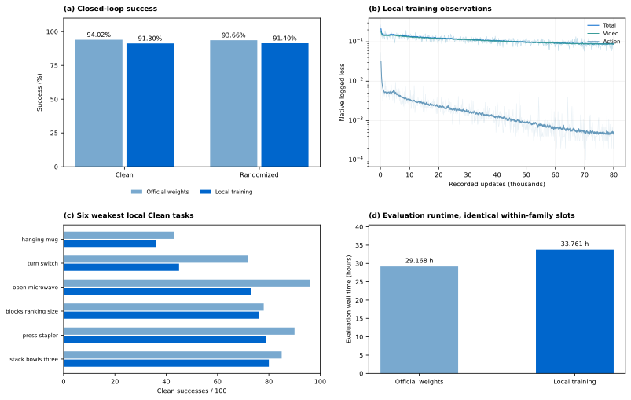

<!-- Generated by scripts/generate_docs.py; edit the source or input data. -->

# OpenWAM · RoboTwin

[Home](../../../../README.md) · [Documentation](../../../README.md) · [All experiments](../../README.md)

[Original paper](https://arxiv.org/abs/2609.07398) · [Technical report](../../../report/README.md)

## Setup and inherited components

Wan2.2-TI2V-5B and ActionDiT with joint self-attention; frozen Wan VAE and T5. Local adaptation inherits Foundation step 154000: four H200 NVL GPUs, BF16, ZeRO-2, AdamW, global batch 64 and 80k updates. Three views, 33-frame windows, stride four, 384 × 320 images; 20 physical end-effector channels in an 80-channel representation.

*OpenWAM architecture and reproduction interfaces.*

## Evaluation protocol

Both scenes, each 50 tasks × 100 episodes; unseen instructions, seed 0, four GPUs and 16 rollout slots. Evaluator 0aeea2d requests observations at chunk start and checks success after every action. Both checkpoints share this adapted execution path.

| Checkpoint | Clean successes / episodes | Randomized successes / episodes | Local training GPU-hours | Weights |
| --- | --- | --- | --- | --- |
| [OpenWAM official](README.md) | 4,701/5,000 (94.02%) | 4,683/5,000 (93.66%) | — | [ModelScope](https://www.modelscope.cn/models/InPeerReview/RoboSeed/tree/master/models/RoboSeed-OpenWAM-Alpha-RoboTwin-official-step118655) |
| [OpenWAM local](README.md) | 4,565/5,000 (91.30%) | 4,570/5,000 (91.40%) | 262.068 | [ModelScope](https://www.modelscope.cn/models/InPeerReview/RoboSeed/tree/master/models/RoboSeed-OpenWAM-Alpha-RoboTwin-local-step80000) |

## Interpretation and measured cost

Official and local two-scene means are 93.84% and 91.35%, a 2.49-point adaptation gap. The local interval is 262.068 H200 GPU-hours; inherited foundation training is excluded. Local evaluation costs another 135.046 GPU-hours. End-effector actions, inherited priors and evaluator differences prevent attributing cross-family score gaps to architecture alone.

*OpenWAM checkpoint outcomes, native training losses, task profiles and recorded resources.*

## Evidence and downloads

[openwam_training_observations.csv](../../../../data/openwam_training_observations.csv)

[All task counts](task_results.md) · [Checkpoint registry and package dependencies](../../../releases/README.md)

Each ModelScope folder contains its model card, available configuration and normalization assets. Follow that card for the compatible method implementation and external encoders. The branch `master` is mutable; the package registry records observed weight hashes.
