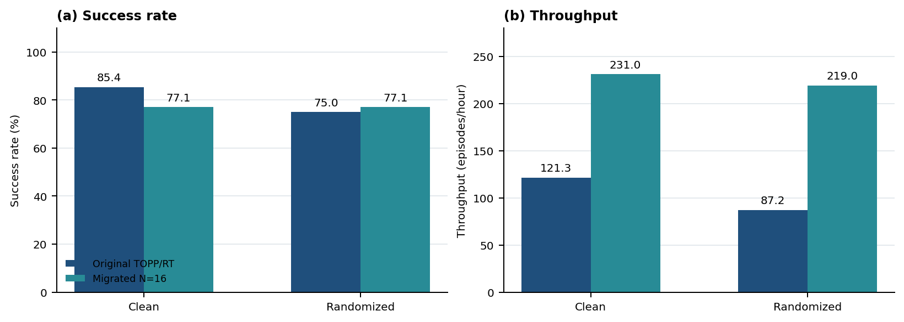
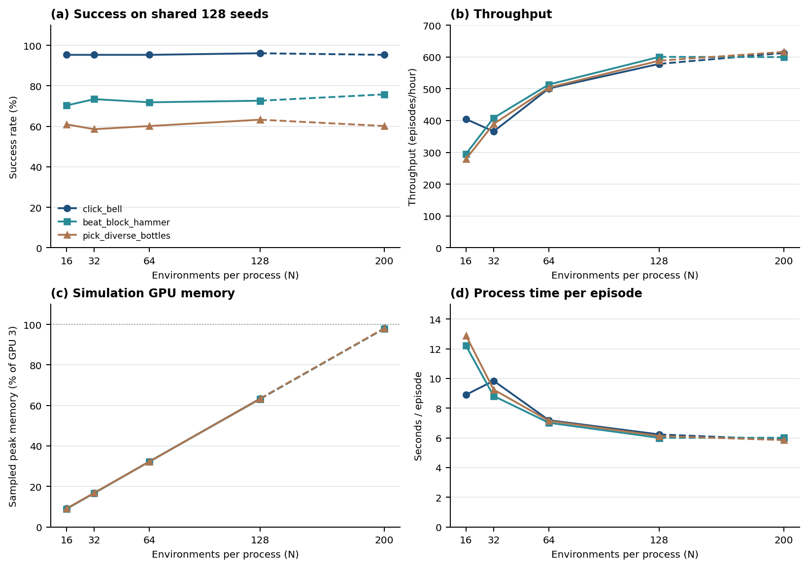

# RoboSeed-Sim experiments

[Home](../../../README.md) · [Report](../../report/roboseed-sim/README.md) · [Data](../../../data/roboseed_sim/README.md)

This independent systems study uses LingBot-VLA-v2 6B, checkpoint `global_step_50000`, to evaluate the migration of RoboTwin to GPU-parallel simulation. It does not introduce a new trained policy. Evidence ends on November 20, 2026; the initial Chinese report was assembled on November 22.

## Systems and protocol

The original reference uses single-environment TOPP/RT. The migrated system combines GPU PhysX, camera-group rendering, batched VLA requests, direct control, up to 17 physics substeps per control action and a 2,500-step initialization settling stage. These necessary adaptations are part of the complete system under comparison. Component-level attribution requires separate experiments.

Recent system comparisons reuse each scenario's saved seeds and instructions. The original system uses one evaluation slot; the migrated system runs one process with N environments, launching multiple batches sequentially where required. Scaling runs use GPU 2 for inference and GPU 3 for simulation, and match per-environment sampling noise by task, environment seed, action-chunk index and repeat index 0. This preserves stochastic sampling and does not guarantee identical model outputs or physical trajectories.

Full-task clean and randomized sets were screened independently. The 128-seed scaling sets reuse 100 historically expert-passed seeds per task and add 28; N=200 adds another 72. Model-independent expert screening is excluded from the reported process durations. Historical full-task single-environment GPU results used up to three workers; their topology should not be substituted for the recent one-slot comparisons.

## Selected comparisons

| Experiment | Coverage | Packaged evidence |
| --- | --- | --- |
| Historical clean configurations | Seven configurations, 50 tasks each; original TOPP/RT 5,000 episodes, others 800 | [Configuration counts](../../../data/roboseed_sim/historical_configurations.csv), [historical paired outcomes](../../../data/roboseed_sim/historical_paired_results.csv) |
| Full-task migrated N=16 | 800 clean and 800 randomized episodes | [Task outcomes and times](../../../data/roboseed_sim/full_task_results.csv), [episode outcomes](../../../data/roboseed_sim/full_episode_results.csv) |
| Small clean/randomized system comparison | Three tasks × 16 episodes per scenario and system | [Run summary](../../../data/roboseed_sim/small_system_compare.json), [matched episodes and instructions](../../../data/roboseed_sim/small_paired_episodes.csv) |
| Two-task system comparison | 64 episodes per task and system | [Original outcomes and lineage](../../../data/roboseed_sim/two_task_original.json) |
| Single-process scaling | Three clean tasks; N=16/32/64/128 each process 128 episodes, N=200 processes 200 | [Run outcomes, seeds and instructions](../../../data/roboseed_sim/scaling_runs.json), [summary](../../../data/roboseed_sim/scaling_summary.csv), [GPU samples](../../../data/roboseed_sim/gpu_samples.csv) |
| Hammer diagnostic | Two N=64 closed-loop runs and replay of the first action set | [Replay outcomes](../../../data/roboseed_sim/hammer_replay.json) |
| Historical framework repairs | Five before/after observations, 16 episodes each | [Transcribed historical counts and validation modes](../../../data/roboseed_sim/historical_repair_counts.json) |

The two-task migrated 64-episode results are the first four N=16 batches of the 128-episode scaling reference, not independent repetitions. Historical configuration and repair summaries are imported records; their original sources are identified and hashed, but the complete raw traces are not all bundled in this initial snapshot.

## System efficiency

| Scene | Original TOPP/RT | Migrated N=16 | Throughput ratio |
| --- | --- | --- | --- |
| Clean | 41/48; 1,425.01 s; 121.3 episodes/hour | 37/48; 748.01 s; 231.0 episodes/hour | 1.91× |
| Randomized | 36/48; 1,981.93 s; 87.2 episodes/hour | 37/48; 788.94 s; 219.0 episodes/hour | 2.51× |

The left panel shows success; the right shows throughput computed from the sum of selected process durations. Neither panel establishes a full-task speedup or a component-level effect. Successful termination, actual executed steps, startup and the native execution path can affect process time.

## Environment count and resources

Panel (a) compares success on the common first 128 seeds. Panels (b) and (d) use each run's actual workload; the dashed N=128-to-200 segments mark the change from 128 to 200 episodes. Panel (c) reports sampled peak memory on a 143,771 MiB H200 NVL. N=200 reaches approximately 98% of capacity, while throughput improves only modestly from N=128 in this run. Mean process time per episode is an amortized processing cost, not individual episode latency.

There is no common monotonic success decline across these three clean tasks, but per-seed outcomes differ. Some runs also shared host CPU, memory and I/O with other work. Fixed-workload repetitions and broader task coverage are needed to identify a stable saturation point and bottleneck.

## Timing and implementation scope

Reported throughput is episodes divided by summed recorded process duration. It excludes expert screening, complete scheduling waits and all interrupted or repeated attempts. Historical twelve-episode timing used an initialization-plus-loop boundary and is retained separately in the report appendix. Nested stage timers cannot be added as independent stages, and asynchronous GPU work needs explicit synchronization boundaries for attribution.

Camera-group rendering and CUDA image acquisition are implemented. Images are subsequently converted to CPU NumPy and sent to a separate VLA service over WebSocket. CPU-side compensation and some initialization and success-check loops remain. The initial repository addition packages evidence and report reproduction, rather than the complete simulator and serving adapters.
