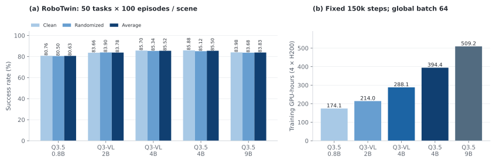

<!-- Generated by scripts/generate_docs.py; edit the source or input data. -->

# Experimental findings

[Home](../../README.md) · [Documentation](../README.md) · [All experiments](../experiments/README.md)

These observations come from the October 28, 2026 evidence snapshot of the [technical report](../report/README.md) and its packaged counts and loss records. They describe the recorded ABot-M0 recipes and software environment. Backbone names denote the VLM component; each trained policy also contains action and spatial modules.

## Backbone scale and training budget

| VLM backbone | Clean (%) | Randomized (%) | Average (%) | Training GPU-hours | Weights |
| --- | --- | --- | --- | --- | --- |
| [Qwen3.5-0.8B](../experiments/abot-m0/robotwin/qwen3-5-0-8b.md) | 80.76 | 80.50 | 80.63 | 174.1 | [ModelScope](https://www.modelscope.cn/models/InPeerReview/RoboSeed/tree/master/models/RoboSeed-ABot-M0-RoboTwin-Qwen3.5-0.8B) |
| [Qwen3-VL-2B](../experiments/abot-m0/robotwin/qwen3-vl-2b.md) | 83.66 | 83.90 | 83.78 | 214.0 | [ModelScope](https://www.modelscope.cn/models/InPeerReview/RoboSeed/tree/master/models/RoboSeed-ABot-M0-RoboTwin-Qwen3-VL-2B) |
| [Qwen3-VL-4B](../experiments/abot-m0/robotwin/qwen3-vl-4b.md) | 85.70 | 85.34 | 85.52 | 288.1 | [ModelScope](https://www.modelscope.cn/models/InPeerReview/RoboSeed/tree/master/models/RoboSeed-ABot-M0-RoboTwin-Qwen3-VL-4B) |
| [Qwen3.5-2B](../experiments/abot-m0/robotwin/qwen3-5-2b.md) | 84.30 | 83.94 | 84.12 | 212.9 | [ModelScope](https://www.modelscope.cn/models/InPeerReview/RoboSeed/tree/master/models/RoboSeed-ABot-M0-RoboTwin-Qwen3.5-2B) |
| [Qwen3.5-4B](../experiments/abot-m0/robotwin/qwen3-5-4b.md) | 85.88 | 85.12 | 85.50 | 394.4 | [ModelScope](https://www.modelscope.cn/models/InPeerReview/RoboSeed/tree/master/models/RoboSeed-ABot-M0-RoboTwin-Qwen3.5-4B) |
| [Qwen3.5-9B](../experiments/abot-m0/robotwin/qwen3-5-9b.md) | 83.98 | 83.68 | 83.83 | 509.2 | [ModelScope](https://www.modelscope.cn/models/InPeerReview/RoboSeed/tree/master/models/RoboSeed-ABot-M0-RoboTwin-Qwen3.5-9B) |

Qwen3-VL-4B reaches 85.52% at 288.1 training GPU-hours; the 0.8B run reaches 80.63% at 174.1 GPU-hours. The two 4B averages differ by 0.02 percentage points. Qwen3.5-9B uses 29.1% more training GPU-hours than Qwen3.5-4B and scores 1.67 percentage points lower.

All completed runs match training data, updates, batch, and evaluation denominators. Equal updates do not equalize compute, and the recorded training seed is not a multi-seed study. Close aggregate scores do not establish statistical equivalence.

*Closed-loop success and measured training-device time for the six completed RoboTwin backbones.*

## Optimization and robot execution

The late-window mean below uses raw observations with `140000 < step <= 150000`, matching the report figure. It is distinct from the final single logged loss.

| VLM backbone | Last-10k mean action loss | Observations | RoboTwin average (%) |
| --- | --- | --- | --- |
| [Qwen3.5-0.8B](../experiments/abot-m0/robotwin/qwen3-5-0-8b.md) | 0.00110976 | 100 | 80.63 |
| [Qwen3-VL-2B](../experiments/abot-m0/robotwin/qwen3-vl-2b.md) | 0.00110434 | 100 | 83.78 |
| [Qwen3-VL-4B](../experiments/abot-m0/robotwin/qwen3-vl-4b.md) | 0.00101430 | 100 | 85.52 |
| [Qwen3.5-2B](../experiments/abot-m0/robotwin/qwen3-5-2b.md) | 0.00096884 | 100 | 84.12 |
| [Qwen3.5-4B](../experiments/abot-m0/robotwin/qwen3-5-4b.md) | 0.00095506 | 100 | 85.50 |
| [Qwen3.5-9B](../experiments/abot-m0/robotwin/qwen3-5-9b.md) | 0.00095817 | 100 | 83.83 |

Qwen3.5-4B and 9B reach similar late-window losses while their rollout success differs. Use training curves to inspect convergence and rollouts to measure execution. Qwen3.5-2B now has complete evaluation: 84.30% Clean, 83.94% Randomized and 84.12% average at 212.9 training GPU-hours.

*Six independent training panels with identical axes, raw observations, moving averages, and separately measured rollout scores.*

## Task-level differences

Aggregate scores hide different task profiles. The following counts compare Qwen3.5-4B and 9B; each scene/task has 100 episodes.

| Task | 4B Clean / Randomized successes | 9B Clean / Randomized successes |
| --- | --- | --- |
| hanging_mug | 30 / 34 | 38 / 36 |
| stack_bowls_three | 82 / 80 | 85 / 88 |
| click_alarmclock | 22 / 13 | 3 / 9 |
| pick_dual_bottles | 85 / 83 | 72 / 67 |

The larger backbone improves some tasks and regresses on others. The [complete task table](../datasets/robotwin/task_results.md) preserves all outcomes. These observations do not identify a causal module or controller defect.

## Robustness beyond standard LIBERO

| Benchmark | Post-train updates | Evaluation counts | Result | Weights |
| --- | --- | --- | --- | --- |
| [LIBERO](../experiments/abot-m0/libero/qwen3-5-4b.md) | 40k | 1,935/2,000 | 96.75% | [ModelScope](https://www.modelscope.cn/models/InPeerReview/RoboSeed/tree/master/models/RoboSeed-ABot-M0-LIBERO-Qwen3.5-4B) |
| [LIBERO-plus](../experiments/abot-m0/liberoplus/qwen3-5-4b.md) | No extra training | 8,027/10,030 | 80.03% | [ModelScope](https://www.modelscope.cn/models/InPeerReview/RoboSeed/tree/master/models/RoboSeed-ABot-M0-LIBERO-Qwen3.5-4B) |

LIBERO-plus evaluates the same LIBERO checkpoint without extra training. Its variants differ from standard LIBERO tasks, so the score gap describes the two evaluation settings.

| Perturbation category | Successes / variants | Success (%) |
| --- | --- | --- |
| Background Textures | 1012/1076 | 94.05 |
| Camera Viewpoints | 1050/1599 | 65.67 |
| Language Instructions | 1289/1537 | 83.86 |
| Light Conditions | 1084/1142 | 94.92 |
| Objects Layout | 1206/1525 | 79.08 |
| Robot Initial States | 942/1550 | 60.77 |
| Sensor Noise | 1444/1601 | 90.19 |

Robot initial states and camera viewpoints have the lowest category rates in this snapshot. Category difficulty and composition differ. Each variant is evaluated once; the data do not estimate its repeat-execution stability. The [duplicate audit](../../data/liberoplus_duplicates.json) retains all alternatives, including three conflicting verdicts.

## High-dimensional control on RoboCasa

The independently trained GR1 Tabletop policy achieves 574/1200 successes across 24 tasks with 29-dimensional absolute joint targets. The report describes observed missed approaches, object sweeps, and unsuccessful grasps followed by timeouts. State-following shortcuts and learning-rate effects remain hypotheses: a controlled ablation is absent. See the [experiment and all task outcomes](../experiments/abot-m0/robocasa-tabletop/qwen3-5-4b.md).

## Skill composition on CALVIN

| Benchmark | Post-train updates | Evaluation counts | Result | Weights |
| --- | --- | --- | --- | --- |
| [CALVIN · ABCD → D](../experiments/abot-m0/calvin/qwen3-5-4b.md) | 34k | 1,000 five-task sequences | Mean length **3.625 / 5**; five tasks **57.1%** | [ModelScope](https://www.modelscope.cn/models/InPeerReview/RoboSeed/tree/master/models/RoboSeed-ABot-M0-CALVIN-Qwen3.5-4B) |

| Task group | Successes / reached attempts | Conditional success (%) |
| --- | --- | --- |
| Horizontal push | 196/423 | 46.34 |
| Push left | 133/217 | 61.29 |
| Push right | 63/206 | 30.58 |
| Other tasks | 3429/3631 | 94.44 |

Left and right pushes partition the horizontal-pushing group; the other task types form its complement. Task frequencies and positions differ, so these conditional rates are diagnostic. All five prefix counts use all 1,000 sequences, while task outcomes use only reached attempts. The setting is ABCD → D, with D included in training. See the [CALVIN protocol and source audit](../experiments/abot-m0/calvin/qwen3-5-4b.md).

## Resource measurements and release coverage

Training GPU-hours are allocated device count multiplied by training wall time. They exclude evaluation and do not measure energy, utilization, or money. Approximate memory readings, especially the Qwen3.5 4B/9B values, require reconciliation with device capacity and monitoring conventions. RoboTwin rollout wall times retain each run's software, concurrency, and shared-host conditions; they do not measure policy latency.

The repository includes audited counts, recorded configs, analysis tools, figures, and the report. Training implementation, simulator adapters, raw videos, datasets, and trained weights are external. The [release registry](../releases/README.md) distinguishes locally verified artifacts from public downloads.

## Additional reproduced models

**Experimental objective.** RoboSeed studies model behavior under practical, limited-hardware training budgets, using the ABot-M0 downstream study as the comparison reference. Some official training recipes require resources beyond this setting, so local runs adapt their batch sizes, training durations and execution settings to the available hardware. The goal is to compare models at comparable downstream training scales. The recorded runs below retain their actual budgets; batch size, updates, sample exposure and compute are not all equal across families. A local score below a released checkpoint therefore describes this budget-adapted recipe and does not establish that the original method is weaker.

[Comparison scope and actual training budgets](../reproduction/comparison-protocol.md)

| Checkpoint | Clean successes / episodes | Randomized successes / episodes | Local training GPU-hours | Weights |
| --- | --- | --- | --- | --- |
| [LingBot 6B · released weights](../experiments/lingbot-vla2/robotwin/README.md) | 4,486/5,000 (89.72%) | — | — | [ModelScope](https://www.modelscope.cn/models/InPeerReview/RoboSeed/tree/master/models/RoboSeed-LingBot-VLA2-6B-RoboTwin-official-step50000) |
| [LingBot 6B · local budget run](../experiments/lingbot-vla2/robotwin/README.md) | 2,889/5,000 (57.78%) | — | 174.365 | [ModelScope](https://www.modelscope.cn/models/InPeerReview/RoboSeed/tree/master/models/RoboSeed-LingBot-VLA2-6B-RoboTwin-local-step50000) |
| [OpenWAM · released weights](../experiments/openwam/robotwin/README.md) | 4,701/5,000 (94.02%) | 4,683/5,000 (93.66%) | — | [ModelScope](https://www.modelscope.cn/models/InPeerReview/RoboSeed/tree/master/models/RoboSeed-OpenWAM-Alpha-RoboTwin-official-step118655) |
| [OpenWAM · local budget run](../experiments/openwam/robotwin/README.md) | 4,565/5,000 (91.30%) | 4,570/5,000 (91.40%) | 262.068 | [ModelScope](https://www.modelscope.cn/models/InPeerReview/RoboSeed/tree/master/models/RoboSeed-OpenWAM-Alpha-RoboTwin-local-step80000) |
| [LiLa-WAM · released weights](../experiments/lila-wam/robotwin/README.md) | 224/250 (89.60%) | — | — | [ModelScope](https://www.modelscope.cn/models/InPeerReview/RoboSeed/tree/master/models/RoboSeed-LiLa-WAM-RoboTwin-official-stage2-epoch4) |
| [LiLa-WAM · local budget run](../experiments/lila-wam/robotwin/README.md) | 222/250 (88.80%) | — | — | [ModelScope](https://www.modelscope.cn/models/InPeerReview/RoboSeed/tree/master/models/RoboSeed-LiLa-WAM-RoboTwin-local-stage2-epoch4) |

Released-weight rows are official checkpoints evaluated locally; local-budget rows use our adapted recipes. They are not original-paper leaderboard comparisons.

[PX harness systems results](../experiments/px-harness/README.md) · [Five-dimension evaluation framework](assessment.md)
