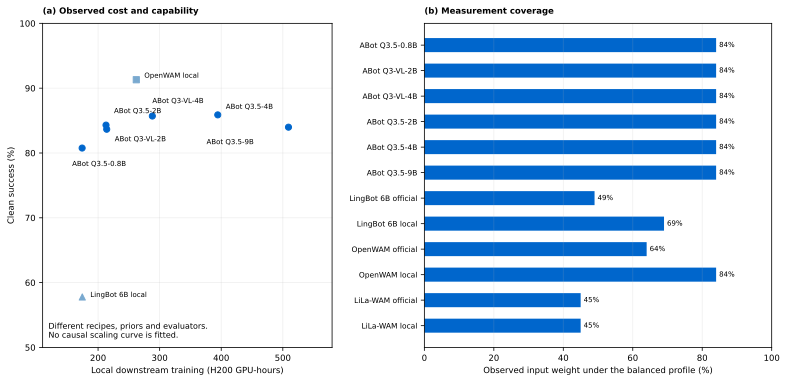

<!-- Generated by scripts/generate_docs.py; edit the source or input data. -->

# RoboSeed evaluation framework · policy 1.1

[Home](../../README.md) · [Documentation](../README.md) · [All experiments](../experiments/README.md)

The decision unit is a checkpoint, training recipe, interface and evaluator tuple. The report defines five dimensions: capability P, downstream training affordability T, deployment affordability D, locally verified research value V and reproduction evidence R. These are declared decision rules, not a universal architecture ranking.

P requires both Clean and Randomized outcomes. T uses the measured local H200 interval and fixed 64–1,024 GPU-hour anchors. D requires primary artifact size, warmed inference peak memory and p95 request latency; every D is missing in this snapshot. V and R follow the report’s binary evidence criteria. Missing components remain absent; no weights are renormalized and no composite is calculated without every required component.

| Checkpoint | P | T | D | V | R | Balanced composite |
| --- | --- | --- | --- | --- | --- | --- |
| ABot Qwen3.5-0.8B | 80.63 | 63.90 | — | 75.00 | 80.00 | — |
| ABot Qwen3-VL-2B | 83.78 | 56.46 | — | 75.00 | 80.00 | — |
| ABot Qwen3-VL-4B | 85.52 | 45.74 | — | 75.00 | 80.00 | — |
| ABot Qwen3.5-2B | 84.12 | 56.65 | — | 75.00 | 80.00 | — |
| ABot Qwen3.5-4B | 85.50 | 34.42 | — | 75.00 | 80.00 | — |
| ABot Qwen3.5-9B | 83.83 | 25.20 | — | 75.00 | 80.00 | — |
| LingBot 6B official | — | — | — | 50.00 | 60.00 | — |
| LingBot 6B local | — | 63.85 | — | 50.00 | 80.00 | — |
| OpenWAM official | 93.84 | — | — | 50.00 | 60.00 | — |
| OpenWAM local | 91.35 | 49.16 | — | 50.00 | 80.00 | — |
| LiLa-WAM official | — | — | — | 50.00 | 40.00 | — |
| LiLa-WAM local | — | — | — | 50.00 | 40.00 | — |

*Observed capability and downstream cost, with measurement coverage kept separate from a composite score.*

The balanced profile uses weights 0.30 / 0.20 / 0.20 / 0.15 / 0.15. Training and deployment preference profiles, working Wilson intervals, evidence flags and anchors are retained in the [machine-readable assessment](../../data/assessment.json). LiLa uses visual task tokens and five episodes per task; Clean-only results remain visible on the model page without inventing a two-scene P.
